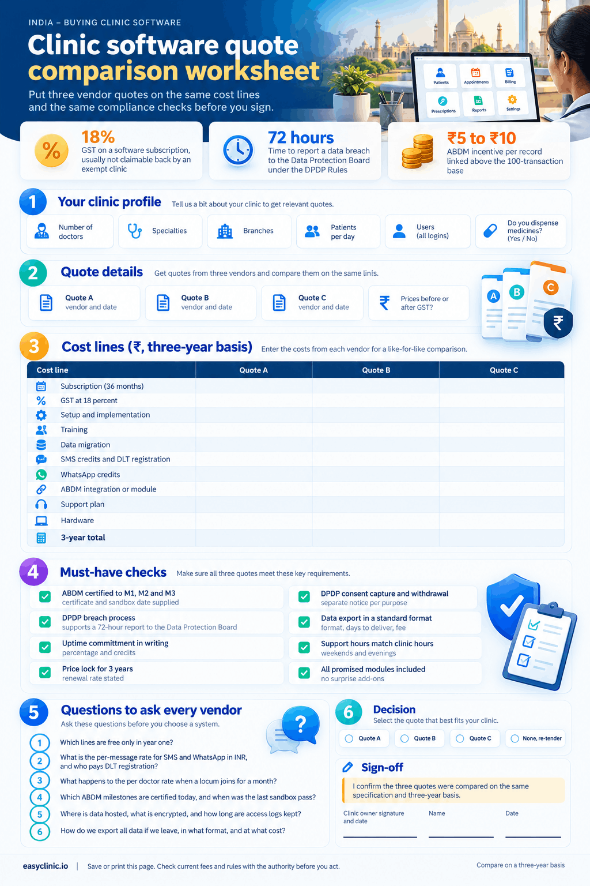

Clinic management software India pricing has no single answer, because vendors sell it five ways: per doctor per month, per clinic per month, per user, as a one-off licence with an annual maintenance contract, or as a custom enterprise quote. No regulator, industry body or newspaper publishes a verified rupee range for private clinic software, so any “typical price” you read online comes from a vendor. The fair method is to collect three quotes on one specification and compare the three-year total, not the monthly headline. This guide shows you how, and what Indian rules add to the bill. If you are still shortlisting, start with the [best clinic management software in India](/best-clinic-management-software-india/) page, then come back here to price it.

## Clinic management software India costs at a glance

| **Question** | **Answer** |
| --- | --- |
| GST on a software subscription | 18 percent, the standard rate for IT services (SAC 9983) under Notification 11/2017, as explained by [ClearTax](https://cleartax.in/s/gst-on-software) |
| GST on your clinic’s own services | Exempt. Health care services by a clinical establishment sit at entry 74 of Notification 12/2017, as applied by the Karnataka High Court on 30 April 2026 in a ruling summarised by [A2Z Taxcorp](https://a2ztaxcorp.net/wp-content/uploads/2026/06/GST-Exemption-on-Healthcare-Services-Available-Even-When-Rendered-Through-Another-Hospital-Under-Revenue-Sharing-Arrangement.pdf) |
| Can you claim the 18 percent back? | Usually not. Section 17(2) of the CGST Act limits input tax credit to the share used for taxable supplies, per the [Act text](https://www.knowyourgst.com/gstlaw/cgst-act/17-apportionment-of-credit-and-blocked-credits-17/) |
| TDS on software fees | Section 194J may apply above ₹50,000 a year; individuals and HUFs below the audit turnover limits need not deduct, per [ClearTax](https://cleartax.in/s/section-194j) |
| Digital health rules | Ayushman Bharat Digital Mission (ABDM): ABHA, Health Facility Registry, Health Professional Registry, software certified through the ABDM sandbox |
| ABDM incentive | Digital Health Incentive Scheme, ₹5 to ₹10 per record linked above a 100-transaction base, current period April to September 2026 under [Corrigendum 7](https://rajswasthya.rajasthan.gov.in/admin/upload/letter/2026/05/40%20Dt.05.05.2026%20NHM%20CSR%20NDHM%20\(ABDM)\-01779-PART-14.pdf) |
| Data protection law | Digital Personal Data Protection Act 2023 and the DPDP Rules 2025, notified 13 November 2025, per [Mondaq](https://www.mondaq.com/india/data-protection/1708164/digital-personal-data-protection-rules-2025-notified) |
| Data breach duty | Detailed report to the Data Protection Board within 72 hours; penalties up to ₹250 crore, per the [Press Information Bureau](https://static.pib.gov.in/WriteReadData/specificdocs/documents/2025/nov/doc20251117695301.pdf) |
| Record retention | 3 years for indoor patient records under regulation 1.3.1 of the [2002 Ethics Regulations](https://www.nmc.org.in/rules-regulations/code-of-medical-ethics-regulations-2002/1000/) |
| Records duty under the Clinical Establishments Act | Section 12(1)(iii): “provisions for maintenance of records and reporting as may be prescribed”, per the [Act](https://indiacode.nic.in/bitstream/123456789/2048/1/A2010-23.pdf) |

## How much does clinic management software cost in India?

The cost of clinic management software in India depends on the pricing model first and the feature list second. Two products with the same features can differ by three times over three years because one bills per doctor and the other bills per clinic with paid add-ons. The sections below explain each model, what pushes the number up, and the one government price point you can use as a floor.

### Clinic management software India: the pricing models you will see

No non-vendor source publishes verified rupee ranges for private clinic software in India. Industry bodies and the business press report funding and adoption, not price lists, and the one academic survey we found on EMR adoption in an Indian private hospital reports barriers as percentages, not rupees ([BMC Health Services Research, May 2025](https://bmchealthservres.biomedcentral.com/articles/10.1186/s12913-025-12877-5)). So the table gives you the model, who it suits and what drives the cost. For the rupee figure, ask for quotes.

| **Pricing model** | **Who it suits** | **What drives the cost** | **Typical range in INR** |
| --- | --- | --- | --- |
| Per doctor per month | Single-doctor and small group clinics that want a predictable bill | Number of doctors, plan tier, annual or quarterly billing | Varies, ask for quotes |
| Per clinic per month | Clinics with many part-time doctors or one busy front desk | Patient volume caps, branch count, add-on modules | Varies, ask for quotes |
| Per user per month | Clinics with a large non-clinical team | Every receptionist, nurse and accountant login counts | Varies, ask for quotes |
| One-off licence plus AMC | Clinics that insist on owning and hosting the software | Licence fee, yearly maintenance contract, your own server, backup and IT | Varies, ask for quotes |
| Custom enterprise quote | Multi-branch chains, polyclinics, nursing homes | Branches, integrations, private hosting, custom features | Varies, ask for quotes |

Two more lines appear on almost every quote whatever the model: a one-off implementation fee, and usage-based credits for SMS and WhatsApp. Treat both as part of the clinic software price in India, not as extras.

### The one government price point you can use as a floor

In June 2026 the Union Health Ministry launched a government-developed, cloud-based hospital management system for small outpatient clinics, built by C-DAC. As reported by [ETV Bharat on 27 June 2026](https://www.etvbharat.com/en/bharat/govt-to-launch-affordable-cloud-based-hospital-management-system-for-small-clinics-on-june-29-enn26062703106), it costs ₹499 a month for up to five users, reduced to ₹299 after a ₹200 subsidy, free for the first three months, with extra users at ₹50 per user per month. It covers registration, billing, reporting and basic documentation. Use it as the floor for a basic system: any commercial quote above it must justify the difference with specialty EMR templates, WhatsApp automation, inventory, insurance claims, support hours or multi-branch control.

### What drives the price up or down

- **Doctors and users.** Per doctor plans grow with every consultant. Per user plans grow with every login. Count both before you compare.
- **Plan tier and branches.** Specialist templates, teleconsultation, lab reporting and multi-location control usually sit in a higher tier, and a second branch often triggers a per-branch fee.
- **Messaging volume.** Reminders and reports sent by SMS or WhatsApp are billed per message, so a busy clinic pays more.
- **Compliance work.** ABDM linking, DPDP consent records and audit logs are either included, sold as a module, or missing. Missing is the most expensive case, because you pay for it later.

## Monthly cost of EMR software for a small clinic in India

The monthly cost of EMR software for a small clinic in India is the subscription plus GST plus messaging credits plus the monthly share of the one-off fees. A quote that shows only the subscription understates your real bill. Use the worksheet to build the full EMR software cost in India for a two-doctor clinic, then repeat it for each vendor. Amounts are blank on purpose: fill them from your quotes, never from a blog.

### Worksheet: monthly cost build-up for a two-doctor clinic

| **Cost line** | **How to calculate it** | **Your amount (₹ per month)** |
| --- | --- | --- |
| Subscription | Per doctor rate times 2, or the per clinic rate, or per user rate times your logins | |
| GST at 18 percent | Subscription times 0.18 (you usually cannot claim it back, see below) | |
| Setup and implementation, spread over 36 months | One-off fee divided by 36 | |
| Training, spread over 36 months | One-off fee divided by 36 | |
| Data migration, spread over 36 months | One-off fee divided by 36 | |
| SMS credits | Messages per month times rate per message, plus DLT registration spread over 36 months | |
| WhatsApp credits | Messages per month times the platform rate for utility or marketing messages | |
| ABDM integration or module | Monthly add-on, or one-off fee divided by 36 | |
| Support plan | Zero if included; otherwise the monthly fee | |
| Hardware share | Tablets, printers, scanners or servers you must buy, divided by 36 | |
| Total monthly cost | Sum of all lines | |

Three checks before you fill it in: is the subscription quoted before or after GST, which lines are free only in year one, and what happens to the per doctor rate when a locum joins for a month.

### GST, TDS and MSME: the tax lines on your invoice

**GST.** A software subscription attracts GST at the 18 percent standard rate for IT services under Notification 11/2017, as set out by [ClearTax](https://cleartax.in/s/gst-on-software). Your own consultations are exempt under entry 74 of Notification 12/2017, which the Karnataka High Court applied again on 30 April 2026 in a judgment summarised by [A2Z Taxcorp](https://a2ztaxcorp.net/wp-content/uploads/2026/06/GST-Exemption-on-Healthcare-Services-Available-Even-When-Rendered-Through-Another-Hospital-Under-Revenue-Sharing-Arrangement.pdf). Because your output is exempt, [section 17(2) of the CGST Act](https://www.knowyourgst.com/gstlaw/cgst-act/17-apportionment-of-credit-and-blocked-credits-17/) limits input tax credit to the part of your business that makes taxable supplies, such as a pharmacy counter. For a consultation-only clinic, the 18 percent is a real cost, and the GST Council kept that standard rate when it moved to two rates from 22 September 2025, per its [press release](https://gstcouncil.gov.in/sites/default/files/2025-09/press_release_press_information_bureau.pdf).

**TDS.** Fees for technical or professional services fall under section 194J. [ClearTax](https://cleartax.in/s/section-194j) lists a ₹50,000 annual threshold, 2 percent for technical services and 10 percent for professional services or royalty. An individual or HUF need not deduct if business turnover did not exceed ₹1 crore, or professional receipts ₹50 lakh, in the previous year. Ask your chartered accountant how a cloud subscription is classified.

**MSME.** Udyam registration is free and permanent, and a micro enterprise can have investment up to ₹2.5 crore and turnover up to ₹10 crore under the limits on the [Udyam portal](https://udyamregistration.gov.in/). It opens MSME credit and delayed-payment protection, but does not change the GST on your software.

## Cloud vs on premise clinic software cost in India

Cloud clinic software costs less to start and more per month; on-premise software costs more to start and shifts the running cost onto your own server, backup, security and IT support. For a clinic with one to three doctors, cloud almost always wins on a three-year total once you add the hardware and the DPDP safeguards. The cloud vs on premise clinic software table shows where each rupee goes.

### Three-year cost comparison

| **Cost line** | **Cloud (subscription)** | **On-premise (licence plus AMC)** |
| --- | --- | --- |
| Software | Monthly or annual subscription for 36 months | One-off licence, then AMC each year (often a percentage of the licence) |
| Server and network | Included in the subscription | Server, UPS, networking, a second machine for backup |
| Backups | Vendor-managed, confirm the schedule in writing | Your responsibility: drives, offsite copy, restore tests |
| Security safeguards under DPDP Rule 6 | Vendor supplies encryption, access logs and monitoring; you confirm them in the contract | You build and run encryption, access control, log retention for at least one year and breach detection |
| Updates for ABDM API versions and GST changes | Pushed by the vendor | Each update may be a paid upgrade or a site visit |
| IT support | Vendor support desk | Local IT contractor or staff time |
| Power and internet outage | Needs internet; ask about offline mode | Runs locally, but a server fault stops every room |
| Scaling to a second branch | Add doctors or a branch to the plan | Second server or a VPN, plus licences |
| Exit | Export your data in a standard format | You own the data but may need the vendor to read it |

### Why Indian rules tilt the maths toward cloud

Two rules move cost from the vendor onto you when you self-host.

The first is the DPDP framework. The [DPDP Rules 2025](https://www.mondaq.com/india/data-protection/1708164/digital-personal-data-protection-rules-2025-notified) were notified on 13 November 2025. The provisions that set up the Data Protection Board took effect at once; the duties on data fiduciaries, including security safeguards, breach reporting and erasure, apply 18 months after notification. [LiveLaw](https://www.livelaw.in/amp/articles/data-privacy-law-in-india-and-digital-personal-data-protection-rules-analysis-310865) lists the Rule 6 safeguards as encryption, masking, access control, activity monitoring and backups, with logs kept for at least one year, and Rule 7 requires a detailed breach report to the Board within 72 hours. The [Press Information Bureau](https://static.pib.gov.in/WriteReadData/specificdocs/documents/2025/nov/doc20251117695301.pdf) puts the top penalty at ₹250 crore for failing to maintain reasonable security safeguards. On a cloud plan, the vendor runs the encryption, logging and monitoring and you confirm it in the contract. On a server in your clinic, you run all of it. Our guide to [patient data privacy laws in India](/patient-data-privacy-laws-in-india/) covers the duties in full.

The second is ABDM. Certification attaches to the software, and the vendor must re-test when the National Health Authority moves API versions. [Corrigendum 7 to the Digital Health Incentive Scheme](https://rajswasthya.rajasthan.gov.in/admin/upload/letter/2026/05/40%20Dt.05.05.2026%20NHM%20CSR%20NDHM%20\(ABDM)\-01779-PART-14.pdf) gave digital solution companies April to June 2026 to complete v3 API compliance. A cloud vendor pushes that change to every clinic at once; an on-premise install waits for a paid upgrade. That is one reason new buyers compare [cloud EMR software in India](/emr-software-in-india/) rather than servers.

## Compliance costs: ABDM, DPDP and record keeping

Compliance is the part of the clinic management software India budget that buyers most often leave out. Three sets of rules add cost lines, and each one is cheaper when the software already does the work.

### ABDM: ABHA, registries, milestones and the incentive

Your clinic registers on the [Health Facility Registry](https://facility.abdm.gov.in) using a Healthcare Professional ID; the portal shows no registration fee. Your software then has to pass the ABDM sandbox. A security testing firm’s [integration checklist](https://qualysec.com/abdm-integration-checklist/), updated 2 September 2026, describes the milestones: M1 covers ABHA creation, verification and registry linking; M2 makes the software a Health Information Provider that links records to an ABHA with consent; M3 makes it a Health Information User that can fetch records from other facilities. Certification needs a functional test report and a Safe-to-Host security certificate. The [Press Information Bureau](https://static.pib.gov.in/WriteReadData/specificdocs/documents/2026/jul/doc202676912801.pdf) reported more than 90 crore ABHA accounts by May 2026, so patients will expect your clinic to link their visit.

There is money on the table, but not much for a small clinic. Under Corrigendum 7, a health facility earns ₹10 per Category 1 record linked (diagnostic report or discharge summary) and ₹5 per other record, after a base of 100 transactions, for April to September 2026. Check the ABDM site for any later corrigendum, and ask the vendor whether the software is certified to M1, M2 and M3 or only to M1. Our [ABDM compliance guide](/abdm-compliance/) explains the registries step by step.

### DPDP: consent, breach process and erasure

Under the Rules, every data fiduciary must give a separate, plain-language consent notice for each purpose, allow withdrawal, notify affected people and the Board after a breach, and erase data once the purpose ends unless a law requires retention ([Mondaq](https://www.mondaq.com/india/data-protection/1708164/digital-personal-data-protection-rules-2025-notified)). For a clinic, that means consent capture at registration, a breach log, and a retention policy the software can enforce. Ask whether these are built in, sold as a module, or left to you.

### Record keeping: NMC, telemedicine and the Clinical Establishments Act

Regulation 1.3.1 of the Indian Medical Council (Professional Conduct, Etiquette and Ethics) Regulations 2002 requires physicians to keep indoor patient records for 3 years, and regulation 1.3.2 requires records to be supplied within 72 hours of a request ([NMC](https://www.nmc.org.in/rules-regulations/code-of-medical-ethics-regulations-2002/1000/)). The NMC’s 2023 replacement regulations also set 3 years and required digital records within 3 years, as summarised by [Economic Laws Practice](https://elplaw.in/leadership/regulating-medical-practice-the-key-reforms-introduced-by-the-registered-medical-practitioner-professional-conduct-regulations-2023/), but the 2002 Regulations remain the code in force as of October 2026, according to a consultancy’s reading of the NMC’s 6 October 2026 advertising guidelines ([Ichelon Consulting](https://ichelonconsulting.com/insights/nmc-2026-guide-for-doctors)). Confirm the position with the NMC before you set a retention rule.

The Telemedicine Practice Guidelines of 25 March 2020, Appendix 5 to the 2002 Regulations, require a digital trail of each teleconsultation and a signed digital prescription for the patient ([Khaitan & Co](https://khaitanco.com/thought-leaderships/Telemedicine-Practice-Guidelines)). If you plan video consultations, the software must store that trail; see our guide to [telemedicine in India in 2026](/telemedicine-in-india-2026/).

Section 12(1)(iii) of the [Clinical Establishments (Registration and Regulation) Act 2010](https://indiacode.nic.in/bitstream/123456789/2048/1/A2010-23.pdf) makes “provisions for maintenance of records and reporting as may be prescribed” a condition of registration, and rule 9 of the 2012 Rules requires rates to be displayed in a conspicuous place, as reported by [LiveLaw on 11 August 2026](https://www.livelaw.in/top-stories/centre-defends-clinical-establishment-rule-in-supreme-court-says-it-curbs-excessive-pricing-of-medical-services-545337). The same report notes that 19 States and Union Territories have adopted the central Act and 17 States have their own legislation, so check your State’s rules too. Our guide to [opening a clinic in India](/clinic-in-india/) covers registration, and the [clinic setup cost in India](/clinic-setup-cost-in-india/) guide shows where software sits in the wider budget.

## Hidden costs to ask about before you sign

| **Hidden cost** | **Why it appears** | **What to ask** |
| --- | --- | --- |
| DLT registration for SMS | TRAI requires sender headers and message templates to be registered on the telecom DLT platform; unverified headers and templates are blocked, per a [TRAI direction summarised by Vikaspedia](https://www.vikaspedia.in/news/trai-issues-directions-to-access-providers-to-stop-misuse-of-message-templates-and-to-curb-unauthorized-promotions-using-telecom-resources) | Who registers the header and templates, and who pays |
| WhatsApp per-message charges | The platform bills per delivered message by category, with India as a separate rate market, per [Meta’s pricing page](https://developers.facebook.com/docs/whatsapp/pricing); service messages beyond 1,000 a month are charged from 1 October 2026 | The rate per utility and marketing message in INR, and who owns the number |
| Data migration | Old paper or spreadsheet records must be typed or imported | The fee per 1,000 records and whether cleaning is included |
| ABDM certification gaps | Software certified to M1 only cannot share records | Which milestones are certified today, with the certificate |
| DPDP tooling | Consent notices, breach log, erasure workflow | Included, module or not available |
| Hardware | Tablets, label printers, barcode scanners, a server for on-premise | A written list of required hardware |
| Price escalation | Renewal at a higher rate after year one | A price lock for 3 years, in writing |
| Data export | Fees or delays when you leave | Export format, time to deliver and cost |
| Support hours | Weekend or evening clinics need weekend support | Hours, channels and response time |

## How to get a fair quote: step by step

1. **Write a one-page specification.** Doctors, users, branches, patients per day, specialties, and whether you need pharmacy, lab, insurance claims or teleconsultation. Send the same page to every vendor.
2. **Ask for a three-year quote, not a monthly rate.** Require every line in the worksheet above, with GST shown separately.
3. **Request the ABDM certificate.** Which milestones are certified, and when the software last passed the sandbox for the current API version.
4. **Get the DPDP answers in writing.** Where data is hosted, what encryption and access logs exist, how long logs are kept, how the vendor supports a 72-hour breach report, and how data is erased or exported when you leave.
5. **Check the messaging bill.** Per-message rates for SMS and WhatsApp, and who pays DLT registration.
6. **Ask for a price lock and an exit clause.** Three years at the quoted rate, and data export in a standard format within a fixed number of days, at no fee.
7. **Run a trial with real workflows.** Register ten patients, write ten prescriptions, bill ten visits and send ten reminders. Time each step.
8. **Compare the three-year totals side by side.** Use the worksheet below. Save the image or rebuild it in your form builder.

***Sample 1:** a quote comparison worksheet that puts three vendor quotes on the same cost lines and the same compliance checks.*

## Common mistakes

- **Comparing monthly rates alone.** A low rate with a high setup fee and a paid ABDM module costs more over three years than a higher rate with everything included.
- **Forgetting GST.** Because your services are exempt, you usually cannot set off the 18 percent. Add it to every quote.
- **Buying on-premise to “own the data” without pricing the server, backups and DPDP safeguards.** You own the risk too.
- **Accepting “ABDM ready” without a certificate.** Ask for the milestone list and the sandbox date.
- **Ignoring messaging volume.** Reminders, reports and follow-ups are billed per message and can rival the subscription in a busy clinic.
- **Signing without a price lock or export clause.** Renewal increases and exit fees are the two most common surprises.

## How Easy Clinic fits in

Easy Clinic is cloud-based clinic management software priced per doctor per month, and you can see current plans on the [pricing page](/pricing/). The Professional plan lists patient management, EMR, billing and payments, appointment scheduling, reports and SMS and email communication; Premium adds WhatsApp communication, video consultation and multi-location management; Enterprise adds insurance and payor management, pharmacy, inventory and private cloud hosting, as shown on the [features page](/features/). The [EMR software in India](/emr-software-in-india/) page covers ABDM and DPDP alignment; ask for the current status in a demo and compare it with the other options on the [best clinic management software in India](/best-clinic-management-software-india/) page.

## Related guides

- [Opening a clinic in India](/clinic-in-india/)
- [Clinic setup cost in India](/clinic-setup-cost-in-india/)
- [How much it costs to open a clinic in Mumbai](/how-much-does-it-cost-to-open-a-clinic-in-mumbai/)
- [Patient data privacy laws in India](/patient-data-privacy-laws-in-india/)
- [ABDM compliance for clinics](/abdm-compliance/)
- [Telemedicine in India in 2026](/telemedicine-in-india-2026/)

## Clinic management software India: common questions

### How much does clinic management software cost in India?

There is no verified public rupee range from a regulator, industry body or newspaper. Vendors price per doctor per month, per clinic per month, per user, or as a licence plus AMC, so compare three quotes on one specification by their three-year total including GST, setup, messaging and ABDM work.

### Is there a cheap clinic software price in India to use as a benchmark?

The government-developed cloud system for small clinics launched in June 2026 costs ₹499 a month for up to five users, ₹299 after subsidy, as reported by ETV Bharat. Use it as a floor for a basic system, not as a benchmark for specialist EMR, WhatsApp automation or multi-branch software.

### What is the monthly cost of EMR software for a small clinic in India?

Subscription plus 18 percent GST plus SMS and WhatsApp credits plus the monthly share of setup, training, migration and hardware. Build the EMR software cost in India line by line from your quotes.

### Is GST charged on clinic software subscriptions?

Yes, at the 18 percent standard rate for IT services. Because health care services by a clinical establishment are exempt under entry 74 of Notification 12/2017, most clinics cannot claim that GST back as input tax credit.

### Do I have to deduct TDS when I pay a software vendor?

Possibly, under section 194J, once payments to one vendor exceed ₹50,000 in a year. Individuals and HUFs below the ₹1 crore business or ₹50 lakh professional turnover limits in the previous year need not deduct. Confirm with your chartered accountant.

### Is cloud or on-premise clinic software cheaper in India?

Cloud is usually cheaper over three years for clinics with one to three doctors, because the vendor carries the server, backups, security safeguards and ABDM updates. On-premise can suit a large facility with its own IT team, once you price the DPDP safeguards.

### Does ABDM integration cost extra?

Sometimes. Some vendors include certified M1 to M3 integration; others sell it as a module or offer M1 only. Ask for the certificate and the milestone list.

### Can my clinic earn money from ABDM?

Under the Digital Health Incentive Scheme, a health facility earns ₹10 per Category 1 record and ₹5 per other record linked, above a base of 100 transactions, for April to September 2026 under Corrigendum 7. Check the ABDM site for any extension.

### What does the DPDP Act mean for my software budget?

The DPDP Rules 2025 require security safeguards such as encryption, access control and logs kept for at least one year, a breach report to the Data Protection Board within 72 hours, consent notices and erasure, with penalties up to ₹250 crore. Software that does this work for you is cheaper than building it yourself.

### How long must I keep patient records?

Regulation 1.3.1 of the 2002 Ethics Regulations requires indoor patient records to be kept for 3 years, and requests must be met within 72 hours. Many clinics keep records longer for medico-legal reasons; make sure the software can enforce your policy.

### Does Easy Clinic publish prices in rupees?

Plans are priced per doctor per month; see current plans on the [pricing page](/pricing/) and ask for a rupee quote on your specification.

This guide is general information, not legal or tax advice. Confirm current rules with the National Health Authority, the Ministry of Electronics and Information Technology, the GST Council and the National Medical Commission.
