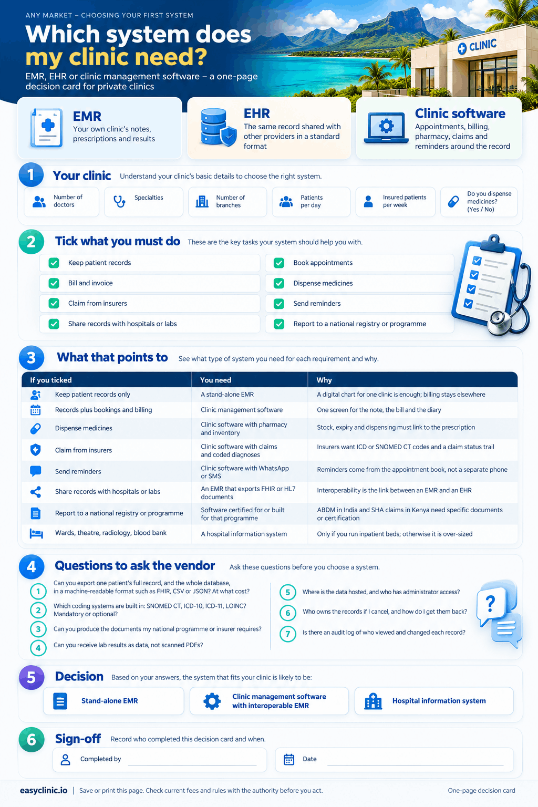

The difference between EMR and EHR is reach. An electronic medical record (EMR) is the digital version of the paper chart inside one clinic. An electronic health record (EHR) is built to follow the patient across clinics, labs and hospitals, which is why the [US Office of the National Coordinator](https://www.healthit.gov/faq/what-are-differences-between-electronic-medical-records-electronic-health-records-and-personal) says EHRs “share information with other health care providers”. Clinic management software is a different thing again. It runs the business of the clinic: bookings, billing, stock, claims and messages, usually with an EMR inside it. Most small private clinics buy that one combined system; the [Easy Clinic features page](/features/) shows what one covers.

The names overlap in daily use. India’s Ministry of Health calls its 2016 standard an [EHR standard](https://esanjeevani.mohfw.gov.in/assets/guidelines/ehr_guidlines.pdf). Malaysia’s Ministry of Health calls the systems it plans for all public hospitals and primary care facilities by 2029 EMRs ([Malay Mail, 11 October 2026](https://www.malaymail.com/news/malaysia/2026/10/11/malaysia-has-spent-decades-digitising-public-healthcare-why-are-paper-records-still-in-use/236366)). [NHS England](https://transform.england.nhs.uk/digitise-connect-transform/digitising-the-frontline) says EPR. Two questions matter more than the label: can the record leave your clinic in a format another system can read, and does the system also run your front desk and your cash.

## EMR vs EHR at a glance

| **Term** | **What it holds** | **Who uses it** | **Typical buyer** |
| --- | --- | --- | --- |
| EMR (electronic medical record) | Visit notes, diagnoses, prescriptions, results, for one clinic | The doctors and nurses in that clinic | A solo doctor or a single clinic |
| EHR (electronic health record) | The same clinical data, plus records from other providers, in a shared standard format | Every authorised provider who treats the patient, and the patient | Hospitals, health networks, national programmes such as ABDM in India |
| Practice or clinic management software | Appointments, billing, invoices, inventory, pharmacy, insurance claims, reminders, reports | Reception, billing staff, the pharmacist, the owner | Private clinics of 1 to 20 doctors |
| HIS or HMIS (hospital or health management information system) | Everything above plus wards, theatres, radiology, labs, HR and finance | Whole hospitals and, in some countries, national reporting systems | Hospitals, large polyclinics, ministries |
| Patient portal or PHR (personal health record) | The patient’s own view: results, visit summaries, bills, bookings, messages | The patient and their family | Clinics that want patients to self-serve |

The ONC describes a PHR as a record “designed to be set up, accessed, and managed by patients” ([HealthIT.gov](https://www.healthit.gov/faq/what-are-differences-between-electronic-medical-records-electronic-health-records-and-personal)).

## What EMR, EHR, clinic management software and HIS mean

### EMR: the chart for one clinic

The ONC describes EMRs as “digital versions of the paper charts in clinician offices, clinics, and hospitals”, holding the notes clinicians in that setting use for diagnosis and treatment ([HealthIT.gov](https://www.healthit.gov/faq/what-are-differences-between-electronic-medical-records-electronic-health-records-and-personal)). The record stays where it was made. If a patient moves to another clinic, the chart is printed or emailed, not transferred as data.

### EHR: the record that follows the patient

The international definition in ISO/TR 20514, published in 2005, describes an EHR as a secure, computer-processable repository of a person’s health information, stored in a standardised structure independent of any one system, and accessible to multiple authorised users ([ISO/TR 20514:2005](https://www.iso.org/standard/39525.html), quoted in the [IEC Electropedia](https://electropedia.org/iev/iev.nsf/IEVref_xref/en:871-06-01)). India’s [EHR Standards for India, 2016](https://esanjeevani.mohfw.gov.in/assets/guidelines/ehr_guidlines.pdf) use almost the same words: repositories of health information about an individual, “capable of being stored and communicated securely and of being accessible by multiple authorized users”.

Three things make a record an EHR rather than an EMR: a standard structure, a way to send and receive it, and more than one organisation reading it.

### Practice management and clinic management software

Practice management software runs the non-clinical side of the clinic: the diary, the queue, bills and receipts, stock, insurer claims and patient messages. “Clinic management software” is the same category with the EMR included, so the note and the bill come from one screen. No regulator defines it, so the term means whatever is on the vendor’s feature list.

### HIS and HMIS

A hospital information system (HIS) adds the departments a clinic does not have: wards, theatre scheduling, radiology, blood bank, HR and full accounting. In public health the letters mean a national system: Kenya’s [Digital Health Act, 2023](https://new.kenyalaw.org/akn/ke/act/2023/15/eng@2023-11-24) defines a “health information system” as a health ecosystem designed to manage health and health related system data. In Kenya, the Social Health Authority expects claims from a system certified by the Digital Health Agency; 28 private platforms had been certified by 2 October 2026 ([CIO Africa](https://cioafrica.co/duale-pushes-hmis-deadline-to-october-30-after-ordering-hard-cutoff-for-sha-portal/)).

### Patient portal

A website where patients book appointments, request refills, pay bills, view results and message the clinic ([MedlinePlus, reviewed 23 July 2024](https://medlineplus.gov/ency/patientinstructions/000880.htm)). It is a feature of a clinic system, not a separate record.

## EMR vs EHR for private clinics

For a private clinic, EMR vs EHR is not a choice between two products. It is a question about one product: can its records be shared in a standard format when a hospital, an insurer or a government programme asks for them.

### Interoperability is the real difference between EMR and EHR

Interoperability is the ability of different systems to exchange data and use it. HIMSS describes four levels: foundational (one system can send data to another), structural (the data arrives in an agreed format), semantic (both sides mean the same thing by each code) and organisational (the consent, policy and trust that let sharing happen) ([HIMSS](https://www.himss.org/resources/interoperability-healthcare)). A PDF emailed to a hospital reaches level one. A diagnosis coded in SNOMED CT inside a FHIR document reaches level three.

Governments are moving the line to level three. India’s Ayushman Bharat Digital Mission (ABDM) had linked more than 104 crore health records to more than 93 crore ABHA accounts by July 2026, and records move between providers only with the patient’s time-bound consent ([Press Information Bureau, 6 July 2026](https://static.pib.gov.in/WriteReadData/specificdocs/documents/2026/jul/doc202676912801.pdf)). The format for those records is a published [FHIR implementation guide for ABDM](https://nrces.in/ndhm/fhir/r4/index.html), with profiles for an outpatient consultation, a prescription, a diagnostic report and a discharge summary. A clinic in India needs software that produces those documents; our guide to [ABDM compliance](/abdm-compliance/) covers the registrations.

Kenya’s Act requires the Digital Health Agency to adopt internationally accepted standards and e-health providers to keep their platforms interoperable with the national system ([Digital Health Act, 2023, sections 18 and 43](https://new.kenyalaw.org/akn/ke/act/2023/15/eng@2023-11-24)). Nigeria’s Minister of State for Health said in October 2026 that earlier investments had produced tools that could not communicate, and that the new National Digital Health Architecture rests on a shared health record and “one patient, one health record” ([Premium Times via AllAfrica, 2 October 2026](https://allafrica.com/stories/202610020381.html)). In Abu Dhabi, every licensed facility has had to connect an interoperable EMR to the Malaffi health information exchange since 2020, a condition of facility licensing from 1 April 2021 ([Al Tamimi, 28 September 2020](https://tamimi.com/news/malaffi-emr-integration-required-for-all-abu-dhabi-healthcare-facilities)). Clinics there can compare options on our [EMR software in the UAE](/emr-software-in-uae/) page.

The pattern is the same everywhere. The clinic buys an EMR. The state builds the exchange. The EMR joins the EHR only if it speaks the standards.

### The standards, in plain words

| **Standard** | **What it does** | **Who maintains it** | **What to ask a vendor** |
| --- | --- | --- | --- |
| HL7 FHIR | A format and web method for exchanging health data as “resources” such as Patient, Encounter and Observation, in JSON or XML ([HL7](https://www.hl7.org/fhir/overview.html)) | HL7 International | Can you export a visit as a FHIR document? Which version (ABDM uses R4)? |
| SNOMED CT | A clinical terminology of more than 360,000 concepts for diagnoses, findings and procedures, so two systems mean the same thing ([SNOMED International](https://www.snomed.org/what-is-snomed-ct)) | SNOMED International; free in member countries, which include India, Malaysia, the UAE and South Africa ([members](https://www.snomed.org/members), [licensing](https://www.snomed.org/get-snomed)) | Are diagnoses stored as SNOMED CT codes or free text? |
| ICD-10 and ICD-11 | WHO’s classification of diseases, used for statistics, insurer claims and casemix payment. ICD-11 took effect on 1 January 2022 ([WHO](https://www.who.int/standards/classifications/classification-of-diseases)) | World Health Organization | Which ICD version do you support, and can I map to the one my insurer wants? |
| LOINC | Codes for lab tests and observations, the “question” that a SNOMED CT answer fills ([LOINC](https://loinc.org/get-started/what-loinc-is/)) | Regenstrief Institute | Do lab results arrive with LOINC codes, or as PDFs? |
| HL7 v2 | The older messaging standard most lab analysers and hospital systems still use | HL7 International | Can you receive results from my lab partner or analyser? |
| DICOM | The standard for medical images from X-ray, ultrasound and CT | DICOM Standards Committee | Can you store and view images, or only reports? |

India’s 2016 standard names SNOMED CT as the primary terminology that systems “must use” for clinical information, LOINC for lab and imaging results, and the WHO classifications for statistical reporting ([EHR Standards for India, 2016](https://esanjeevani.mohfw.gov.in/assets/guidelines/ehr_guidlines.pdf)). Those three names are a sound shortlist for any market.

### Side by side: EMR, EHR, clinic management software and HIS

| | **EMR** | **EHR** | **Clinic management software** | **HIS or HMIS** |
| --- | --- | --- | --- | --- |
| Scope | Clinical record for one clinic | Clinical record shared across providers | Clinical record plus front desk, billing and stock | Every department of a hospital |
| Data sharing | Print, PDF, email | Standard documents through an exchange or API | Depends on the EMR inside it | Internal across departments; external through an exchange |
| Standards | Optional | Required: FHIR or HL7, SNOMED CT, ICD, LOINC | Should match the EHR column to be future-proof | HL7 v2 and FHIR, DICOM, ICD |
| Modules | Notes, prescriptions, history, results | As EMR, plus consent, patient access, exchange | Appointments, queue, billing, inventory, pharmacy, claims, reminders, reports | As clinic software, plus wards, theatre, radiology, blood bank, HR, accounts |
| Typical clinic size | 1 doctor | Networks and national programmes | 1 to 20 doctors, one or several branches | 30 beds and up |
| Who regulates | Data protection law; medical council record-keeping rules | National digital health agency plus data protection law | Same as EMR, plus tax rules for invoices | Same as EHR, plus facility licensing |
| Cost model | Low monthly fee or one-off licence | A national programme cost, borne by the state or large providers | Monthly subscription per user or per branch, sometimes per module | Large one-off implementation plus annual support |
| Example of use | A solo paediatrician keeps growth charts and prescriptions | A hospital reads the discharge summary a clinic wrote | A dental clinic books, treats, bills and sends a reminder from one screen | A 200-bed hospital links the ward, pharmacy and lab |
| Risk if chosen alone | Records trapped in one system | Not sold to small clinics; it is infrastructure | Weak EMR inside a strong billing tool | Over-sized and over-priced for a clinic |

## Is EMR the same as practice management software?

No. An EMR holds the clinical record. Practice management software holds the business record: who is booked, who paid, what is in stock and which claims are pending. Many products bundle both, and vendors label the bundle “clinic management software”, “practice management” or even “EMR”. The label does not tell you what is inside.

The test is simple. Open the demo and ask to do four things in one patient visit: book the appointment, write the consultation note with a coded diagnosis, raise the bill with tax, and dispense from stock. If any of those happens in a different product, a spreadsheet or on paper, you are looking at an EMR or a practice management tool, not a complete clinic system.

Then test the EMR half. Ask the vendor to export one patient’s full record in a machine-readable format. If the only option is PDF, the EMR cannot join an EHR, whatever the brochure says.

## Which software does a small clinic need?

A small private clinic needs one system that covers patient records, appointments, billing, dispensing, insurer claims and reminders, with an EMR inside it that can export standard records. That is clinic management software with an interoperable EMR. You do not need a hospital HIS, and you cannot buy an EHR off the shelf, because the EHR is the national or network layer your EMR connects to.

| **Clinic type** | **Must have** | **Add when needed** | **Can skip** |
| --- | --- | --- | --- |
| Solo GP or family physician | EMR with coded diagnoses, appointments, billing with receipts, prescription printing, reminders | Dispensing and stock if you sell medicines; teleconsultation; claims if you take insured patients | Wards, theatre, HR modules |
| Dental clinic | EMR with a tooth chart and treatment plan, appointments, billing, treatment packages, image storage | Lab order tracking for crowns and aligners; recall reminders; multi-chair scheduling | Pharmacy, inpatient modules |
| Multi-doctor polyclinic | Everything for a solo GP, plus a shared queue, role-based access, per-doctor billing and reports, pharmacy, lab orders | Insurer claims with a status dashboard; multi-branch control; a patient portal | Radiology imaging unless you own machines |
| Day-care or minor procedure centre | EMR with consent forms and procedure notes, room scheduling, inventory with expiry tracking, billing with packages | Claims; pre-authorisation tracking; discharge summaries in a standard format | Full inpatient wards, blood bank |

Use the card below to work out your own list. Save the image or rebuild it in your form builder.

***Sample 1:** a one-page decision card. Describe your clinic, tick what you must do, read off what that points to, then ask the vendor the listed questions.*

### When a specialty needs more

Specialty clinics need the same base and one or two deeper modules. Dentists need a tooth chart. Ophthalmologists and dermatologists need images stored against the visit. IVF centres need cycle tracking. Physiotherapists need treatment plans with session counts. Look at a specialty page such as [dental EMR software](/dental-emr-software/) before you compare general products. A generic EMR with a free-text box slows a specialist down every day.

### Where the difference between EMR and EHR matters for a small clinic

Three situations pull a small clinic into the EHR world: a national programme such as ABDM, SHA claims or Malaffi; an insurer that wants coded claims; and a hospital or lab that exchanges results electronically. If any applies within two years, buy for standards now, because migrating records later is where data gets lost.

## How to choose, step by step

1. **List what you do in a week.** Count consultations, prescriptions, bills, dispensed items, lab orders, insured visits and reminders. That list is your module list.
2. **Check the national rules first.** In India, read the [EHR Standards for India, 2016](https://esanjeevani.mohfw.gov.in/assets/guidelines/ehr_guidlines.pdf) and the ABDM requirements. In Kenya, check the Digital Health Agency’s certified list if you will claim from SHA. In Malaysia, the Private Healthcare Facilities and Services Act 1998 carries record-keeping obligations ([Ahmad, Chansanam and Mansor, 2023](https://ebpj.e-iph.co.uk/index.php/EBProceedings/article/view/5008)); see our guide to [opening a clinic in Malaysia](/clinic-in-malaysia/).
3. **Shortlist complete clinic systems, not EMRs alone.** One system is cheaper to run and easier to train than two vendors.
4. **Run the one-visit test in the demo.** Book, note, bill, dispense. Time it. Insist on a coded diagnosis.
5. **Ask the standards and export questions.** Use the list below. Get the answers in writing.
6. **Check data protection.** Ask where the data is hosted, who can access it, whether access is logged, and how you get it back if you leave. Our guides to [patient data privacy laws in India](/patient-data-privacy-laws-in-india/) and [data privacy laws in Kenya](/data-privacy-laws-in-kenya/) list the obligations.
7. **Price the whole thing.** Add the subscription, per-user or per-branch fees, setup and training, message charges and record migration. Compare three-year totals, not the monthly fee.
8. **Pilot with one doctor for a month.** Keep paper alongside, fix the templates, then roll out.

### Questions to ask a vendor about standards and data export

- Can you export one patient’s complete record, and the whole database, in a machine-readable format such as FHIR, CSV or JSON? At what cost?
- Which coding systems are built in: SNOMED CT, ICD-10, ICD-11, LOINC? Are they mandatory fields or optional?
- Can the system produce the documents our national programme or insurer requires, such as an ABDM outpatient consultation record or an electronic claim?
- Can you receive lab results as data, not as scanned PDFs?
- Where is the data hosted, and who has administrator access?
- Who owns the records if I cancel? India’s 2016 standard says providers hold records “in trust” for the patient ([EHR Standards for India, 2016](https://esanjeevani.mohfw.gov.in/assets/guidelines/ehr_guidlines.pdf)); your contract should say the same.
- Is there an audit log of who viewed and changed each record?

### What it costs, in general terms

Cost follows the category. A stand-alone EMR for one doctor is the cheapest option, a low monthly fee or a one-off licence, but it leaves billing and stock elsewhere. Clinic management software is usually a subscription priced per user, per doctor or per branch, sometimes with add-on modules for claims, pharmacy or a patient portal. Hospital systems carry a large implementation fee and an annual support contract. A national EHR is not something a clinic buys; the state funds the exchange and the clinic pays for an EMR that can connect to it. For current Easy Clinic plans, see the [pricing page](/pricing/).

## Common mistakes

- **Buying on the label.** “EHR” on a brochure does not mean the system shares data. Ask for the export and the coding systems.
- **Buying a hospital system for a clinic.** You pay for wards and blood banks you will never open.
- **Free-text diagnoses.** They cannot be claimed, reported or shared. Insist on SNOMED CT or ICD codes from day one.
- **Ignoring the exit.** If the contract does not say how you get your data back, assume you cannot.
- **No pilot.** Going live with every doctor on the same day means every template problem surfaces at once.

## How Easy Clinic fits in

Easy Clinic is clinic management software with the EMR inside it, so the consultation note, the bill, the dispensing record and the insurer claim come from one patient visit. The [features page](/features/) lists EMR with custom templates, appointment and queue management, billing and payments, insurance and third-party payor claims, pharmacy and inventory, lab reporting, WhatsApp and SMS communication and multi-location control, and it lists support for HL7, FHIR, SNOMED, LOINC and ICD-10 coding. Clinics in India can start from the [EMR software in India](/emr-software-in-india/) page, clinics in Kenya from the [EMR software in Kenya](/emr-software-in-kenya/) page, and the [pricing page](/pricing/) has the current plans.

## Related guides

- [ABDM compliance for clinics in India](/abdm-compliance/)
- [Patient data privacy laws in India](/patient-data-privacy-laws-in-india/)
- [Data privacy laws in Kenya](/data-privacy-laws-in-kenya/)
- [Telemedicine in India in 2026](/telemedicine-in-india-2026/)
- [Telemedicine in Kenya in 2026](/telemedicine-in-kenya-2026/)
- [Opening a clinic in Malaysia](/clinic-in-malaysia/)

## EMR vs EHR: common questions

### What is the difference between EMR and EHR in one sentence?

An EMR is a digital chart used inside one clinic, and an EHR is a standardised record designed to be shared by every authorised provider who treats the patient.

### Is an EHR better than an EMR for a small clinic?

Not as a product. A small clinic buys an EMR or a clinic management system; the EHR is the shared layer it connects to. What matters is whether your EMR can export standard records.

### Is EMR the same as practice management software?

No. The EMR holds clinical notes, diagnoses and prescriptions. Practice management software holds appointments, bills, stock and claims. Clinic management software combines the two.

### What does interoperability mean for a clinic?

Your system can send and receive patient data in a format another system can read and understand. HIMSS describes four levels, from a basic connection up to shared meaning through common codes.

### What is HL7 FHIR?

FHIR is HL7’s standard for exchanging health data as building blocks called resources, such as Patient or Observation, in JSON or XML. India’s ABDM uses FHIR R4 for its health documents.

### Does my clinic in India have to follow the EHR Standards 2016?

The Ministry of Health and Family Welfare published them for adoption by providers, and ABDM builds on them. Software that follows them keeps you ready for ABDM record sharing. Confirm current obligations with the National Health Authority.

### Which software does a small clinic need?

One clinic management system with an EMR inside it, covering records, appointments, billing, dispensing, claims and reminders, with standard export. Add specialty modules only where your specialty needs them.

### Can I move my records if I change vendors?

Only if the contract and the software allow a full machine-readable export. Ask for a sample export before you sign.

This guide is general information, not legal advice. Confirm current record-keeping and digital health rules with your national health ministry, digital health agency and data protection authority.
