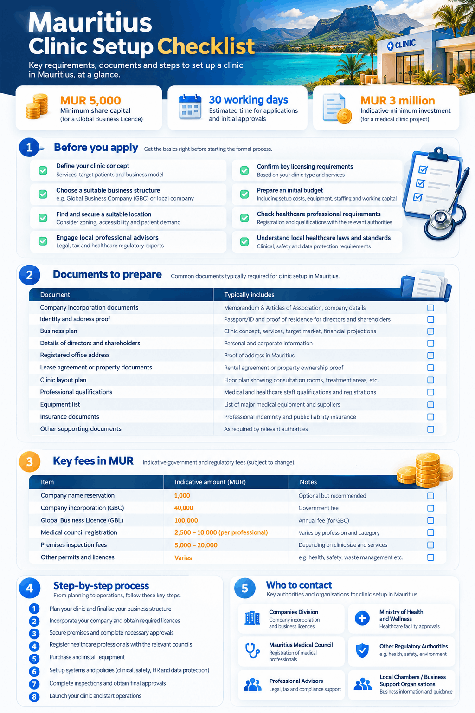

Here is how to open a clinic in Mauritius in one paragraph. Register a company or a business with the Corporate and Business Registration Department. Make sure every doctor holds current registration with the Medical Council of Mauritius. Secure premises with a Building and Land Use Permit and a fire certificate. Then apply to the Permanent Secretary of the Ministry of Health and Wellness for a licence under the Private Health Institutions Act 1989. A small outpatient clinic needs a health care unit licence, which costs MUR 5,000 a year. Before you store a single patient record, register as a data controller with the Data Protection Office, whether your records sit on paper or in [EMR software built for clinics in Mauritius](/emr-software-in-mauritius/).

This guide covers the requirements, the documents, the fees in Mauritian rupees and the order to do things in. It is written for doctors, dentists and practice managers opening a private clinic, a medical centre or a day care unit. The hospital route is noted where it differs. If you have read our guides to [opening a clinic in Uganda](/clinic-in-uganda/) or [starting a clinic in Kenya](/the-ultimate-guide-to-starting-a-clinic-in-kenya/), you will notice one difference at once: Mauritius licenses the premises through a ministry, not a professional council.

## Opening a clinic in Mauritius at a glance

| **Question** | **Answer** |
| --- | --- |
| Who licenses private clinics? | The [Ministry of Health and Wellness](https://health.govmu.org/health/), through its Permanent Secretary |
| Main law | [Private Health Institutions Act 1989](https://health.govmu.org/health/wp-content/uploads/2023/03/PRIVATE-HEALTH-INSTITUTIONS-ACT-1989.pdf), Act 11 of 1989, in force since 1 July 1990 |
| Licence types | Health care unit licence for outpatient, day care and aesthetic clinics; private health (hospital) licence for inpatient facilities; clinical laboratory licence |
| Licence fee | MUR 5,000 a year for a health care unit; MUR 25,000 for a hospital, both renewable every year |
| Doctor registration | Medical Council of Mauritius; MUR 2,500 to register a citizen GP and MUR 2,500 a year to practise |
| Business registration | Corporate and Business Registration Department (CBRD); MUR 3,000 to incorporate a private company |
| Patient data law | Data Protection Act 2017; register with the Data Protection Office for MUR 1,000 to MUR 2,500 per three years |
| VAT | Medical, hospital and dental services are exempt; the standard rate is 15 percent |
| Penalty for an unlicensed clinic | A fine of up to MUR 10,000 and up to 2 years in prison |
| Published processing times | Company incorporation in under a day; Building and Land Use Permit in 14 working days; Medical Council decision within 30 working days; no published time for the Ministry licence |

## Requirements to open a private clinic in Mauritius

The requirements to open a private clinic in Mauritius come from four laws: the Private Health Institutions Act 1989 for the clinic licence, the Medical Council Act 1999 for the doctors, the Companies Act 2001 or the Business Registration Act 2002 for the business, and the Data Protection Act 2017 for patient records. Local permits for the building and fire safety sit on top. The Ministry of Health and Wellness has not published a single checklist, so this section pulls the rules together.

### What counts as a private health institution

The [Private Health Institutions Act](https://health.govmu.org/health/wp-content/uploads/2023/03/PRIVATE-HEALTH-INSTITUTIONS-ACT-1989.pdf) covers four kinds of premises. A **health care unit** is any premises used to examine and treat people, or to treat a condition with a technique or apparatus, but which does not provide board or lodging. A **hospital** receives, lodges and treats patients, and includes a maternity hospital. A **nursing home** lodges people who are convalescing or infirm. A **clinical laboratory** carries out medical investigations, and since the Finance (Miscellaneous Provisions) Act 2024 the definition also covers research and sample collection points.

A GP surgery, a dental practice, a physiotherapy centre, a day care centre or an aesthetic clinic is a health care unit. If you keep patients overnight, you are opening a hospital in the eyes of the Act, and it must fall into one of the classes in the Schedule: medical, surgical, maternity, children’s, or a combination.

| **Licence** | **What it covers** | **Issued by** |
| --- | --- | --- |
| Health care unit licence | Outpatient treatment, day care, aesthetic treatment | Permanent Secretary, Ministry of Health and Wellness |
| Private health (hospital) licence | Private hospitals, medical clinics with beds, super specialty hospitals, inpatient and outpatient care | Permanent Secretary, Ministry of Health and Wellness |
| Clinical laboratory licence | Any premises doing medical investigations, including collection points | Permanent Secretary, after review by the Central Health Laboratory |

The licence categories and what they cover are set out in the Economic Development Board’s [healthcare sector guidelines](https://ahpcmauritius.org/wp-content/uploads/2023/02/Guidelines-Healthcare-Sector.pdf), published in November 2022.

### The licence itself

Section 3 of the Act says anyone who wishes to operate a private health institution applies to the Permanent Secretary in the form the Permanent Secretary determines. The Permanent Secretary may ask for more information, inspect the premises, and then grant the licence on payment of the prescribed fee and on any conditions he sees fit. Under section 5, every licence is renewable each year and must be displayed in a conspicuous part of the clinic. Section 10 makes it an offence to manage an unlicensed private health institution, with a fine of up to MUR 10,000 and up to 2 years in prison.

Two points matter for planning. The Ministry can inspect your premises before it grants the licence, so the building must be finished and equipped before you apply. And the Permanent Secretary can ask at any time for records on staff, drugs, apparatus, patient numbers, the fees you charge and the techniques you use, so keep those records from day one.

### Who can own and run a clinic

The Act does not require the owner to be a doctor. A company, a partnership or an individual can hold the licence. What the law does require is that every clinician is registered with the right council. Under section 22 of the Medical Council Act, as set out on the [Medical Council of Mauritius](https://medicalcouncilmu.org/general-practitioner/) website, a general practitioner must be a citizen of Mauritius, hold a diploma in medicine, show at least 18 months of practical training, and pass the Medical Registration Examination unless exempt. Doctors who practised abroad as a registered GP for at least three years can be exempted if they produce a certificate of good standing from the regulator where they last worked. Non-citizens register on a temporary basis, which also needs a work or occupation permit.

Dentists register with the Dental Council under the Dental Council Act 1999, nurses with the Nursing Council under the Nursing Council Act, and physiotherapists, radiographers, lab technologists and other allied professionals with the Allied Health Professionals Council under the Allied Health Professionals Council Act 2017. Each council charges its own fees, listed in the fee table below.

### Foreign investors

If you are not a citizen, you need an Occupation Permit from the Economic Development Board to live and work in Mauritius as an investor or a professional. The EDB’s [Occupation Permit page](https://www.edbmauritius.org/occupation-permit) lists a minimum transfer of USD 100,000 into the company’s bank account for an investor permit and a minimum basic salary of MUR 60,000 a month for a professional permit, with application fees of MUR 10,000 to MUR 20,000 depending on the length of the permit. Applications go through the National Electronic Licensing System. The EDB processes a complete application in five working days except for regulated activities, and healthcare is one, so expect the Ministry of Health and Wellness to review your project first. The EDB guidelines also note that a company incorporated after 1 July 2021 can apply for an Investment Certificate, which carries an eight-year income tax holiday on healthcare income.

### Requirements summary

| **Requirement** | **Authority** | **Law** |
| --- | --- | --- |
| Registered company, partnership or business | Corporate and Business Registration Department | Companies Act 2001; Business Registration Act 2002 |
| Registered and licensed clinicians | Medical Council, Dental Council, Nursing Council, Allied Health Professionals Council | Medical Council Act 1999; Dental Council Act 1999; Nursing Council Act; Allied Health Professionals Council Act 2017 |
| Building and Land Use Permit for the premises | Municipal or district council, through NELS | Local Government Act 2011 |
| Fire certificate | Mauritius Fire and Rescue Service, through NELS | Mauritius Fire and Rescue Service Act 2013 |
| Health care unit or hospital licence | Permanent Secretary, Ministry of Health and Wellness | Private Health Institutions Act 1989 |
| Pharmacy licence, if you run a pharmacy | Pharmacy Board | Pharmacy Act 1983 |
| Data controller registration | Data Protection Office | Data Protection Act 2017 |
| Tax Account Number, PAYE and social contributions | Mauritius Revenue Authority | Income Tax Act; Value Added Tax Act |
| Occupation Permit for non-citizen owners or doctors | Economic Development Board | Non-Citizens (Employment Restriction) Act |

## Documents needed to open a clinic in Mauritius

The documents needed to open a clinic in Mauritius fall into three bundles: the business bundle for the CBRD and the MRA, the premises bundle for the council and the fire service, and the clinical bundle for the Ministry of Health and Wellness. Gather all three before you apply for the clinic licence, because the Permanent Secretary can request any of them. The Ministry has not published its own document list for a health care unit licence, so the table below combines the project documents listed in the EDB’s healthcare guidelines with what the other authorities require.

| **Document** | **Issued by** | **Why you need it** |
| --- | --- | --- |
| Certificate of incorporation or business registration card | CBRD | Proves the legal entity that will hold the licence |
| Shareholding structure and beneficial owner declaration | Your company, filed with the CBRD | Required by the EDB project brief; the Companies Act now requires a written declaration from each beneficial owner |
| National ID or passport of each promoter | Government of Mauritius or your home country | Identity of the owners |
| Project brief: services, timeline, investment, target market, jobs, financial forecast | Prepared by you | The EDB and the Ministry use it for in-principle approval |
| Source of funds | Your bank | Required with the project brief |
| Title deed, lease or pre-sale agreement | Notary or landlord | Proves you control the premises |
| Location plan and layout plans | Architect or land surveyor | Needed for the Building and Land Use Permit, the fire certificate and the Ministry inspection |
| Building and Land Use Permit | Municipal or district council | Confirms the premises may be used as a clinic |
| Fire certificate and approved fire safety plan | Mauritius Fire and Rescue Service | Commercial premises and premises open to the public must hold one |
| Medical Council registration and current practising certificate for each doctor | Medical Council of Mauritius | Every doctor must be registered and have paid the annual fee |
| Dental, Nursing or Allied Health Professionals Council registration for other clinicians | The relevant council | Same rule for each profession |
| Staff list with qualifications | Prepared by you | The Act lets the Permanent Secretary call for it at any time |
| Equipment list and maintenance contracts | Suppliers | Inspectors check apparatus under section 7 of the Act |
| Waste disposal arrangement for sharps and biological waste | Your waste contractor | Listed by the EDB for laboratories and expected for any clinic |
| Data controller registration certificate | Data Protection Office | Required before you process patient records |
| Tax Account Number and employer registration | Mauritius Revenue Authority | Needed to invoice, pay staff and file returns |
| Pharmacy licence, if applicable | Pharmacy Board | Only if you sell medicines by retail on site |

***Sample 1:** a one-page Mauritius clinic setup checklist with the documents to gather, the fees in MUR, the steps in order and who to contact. Save the image or rebuild it in your form builder.*

## Step by step guide to starting a clinic in Mauritius

This step by step guide to starting a clinic in Mauritius follows the order the authorities expect. You can run some steps in parallel, but the Ministry licence comes last because the inspection needs finished premises and registered staff.

1. **Choose the licence category.** Decide whether you are opening a health care unit (outpatient only) or a hospital (beds). The category sets the fee, the inspection depth and the staffing the Ministry will expect.
2. **Register the business with the CBRD.** Incorporate a private company online through the Corporate and Business Registration Department, or register as an individual under the Business Registration Act if you will practise alone. A private company costs MUR 3,000 to incorporate, according to the [UNCTAD investment guide for Mauritius](https://theiguides.org/public-docs/guides/mauritius), and takes less than a day. An individual’s registration fee under the Act’s Second Schedule starts at MUR 100 for a workforce of up to 10, filed at least two days before trading starts. The Ministry licence is issued to the entity you register here, so get the name right.
3. **Register with the Mauritius Revenue Authority.** Apply for a Tax Account Number, register as an employer for PAYE and social contributions, and decide on VAT. Medical, hospital and dental services are exempt from VAT, so most clinics cannot register, but if you also sell taxable goods or services above MUR 3 million a year you must. The MRA’s [guide on VAT registration](https://mra.mu/download/GuideVATReg.pdf), published in September 2025, confirms the threshold dropped from MUR 6 million to MUR 3 million on 1 October 2025.
4. **Apply for an Occupation Permit if you are not a citizen.** Do this through the EDB’s National Electronic Licensing System before you sign a lease. Regulated activities such as healthcare are reviewed with the Ministry, so start early.
5. **Register every clinician.** Each doctor applies to the Medical Council of Mauritius with their degree, proof of 18 months of pre-registration training, identity documents and, for doctors trained abroad, a certificate of good standing. Since the Finance (Miscellaneous Provisions) Act 2023, the Council must decide an application within 30 working days of the date the file is complete. Dentists, nurses and allied professionals register with their own councils at the same time.
6. **Secure the premises and get the Building and Land Use Permit.** Apply through NELS to the municipal or district council. The [Municipal City Council of Port Louis](https://mccpl.mu/services/land-use-planning/steps-to-follow/) says a complete application is granted within 14 working days, and you have six weeks to answer any request for more information before the system sets the application aside. Check the local Outline Scheme first: a clinic in a residential zone may need a change of use.
7. **Fit out and apply for the fire certificate.** Under section 19 of the Mauritius Fire and Rescue Service Act 2013, commercial premises and any premises the public enters must hold a fire certificate. The [MFRS guideline](https://mfrs.govmu.org/Documents/Guideline%20for%20making%20application%20for%20Fire%20Certificate.pdf) lists health care institutions, including clinics and polyclinics, as a category on the NELS form. There is no application fee; the certificate costs MUR 1,000 for premises up to 1,000 square metres and lasts one to three years depending on the risk assessment.
8. **Register as a data controller.** Section 14 of the [Data Protection Act 2017](https://dataprotection.govmu.org/Documents/DPA_2017.pdf) says no person may act as a controller unless registered with the Data Protection Commissioner. Your application must state that you will hold special categories of personal data, because health data is one. The certificate lasts three years. Apply before you open, not after, since the first patient file you create is personal data.
9. **Apply for the clinic licence.** Submit the application to the Permanent Secretary of the Ministry of Health and Wellness with the documents in the table above. The Ministry may request more information and will inspect the premises. Pay the licence fee when the application is granted: MUR 5,000 for a health care unit or MUR 25,000 for a hospital.
10. **Apply for a pharmacy licence only if you need one.** Section 17 of the [Pharmacy Act 1983](https://www.mcci.org/media/35844/the-pharmacy-act-1983.pdf) says no one may sell medicines by retail outside a pharmacy, with one exception: a medical practitioner may sell medicines if he does not keep an open shop and there is no pharmacy within three miles of where he attends the patient. Anything beyond that needs a pharmacy licence from the Pharmacy Board under section 18, with a pharmacist in charge, renewable every year.
11. **Set up records and billing before the first patient.** Display the licence, open the registers the Permanent Secretary directs under section 6 of the Act, and set up patient records, invoicing in MUR and appointments. If you want one system for all three, compare the [best clinic management software for Mauritius](/best-clinic-management-software-mauritius/) before you print your first paper file.
12. **Diarise the renewals.** The clinic licence renews every year. Doctors pay the annual practising fee by 31 January. The data controller certificate renews every three years, with the application due at least three months before expiry. The fire certificate renews every one to three years.

## How to open a clinic in Mauritius on a known budget: every fee in MUR

These are the official fees we could confirm. They cover licences and registrations only, not rent, fit-out, equipment or salaries. The clinic licence fees come from the EDB’s November 2022 guidelines and were confirmed as the current range of MUR 5,000 to MUR 25,000 a year in a [DLA Piper Africa note](https://www.dlapiperafrica.com/en/mauritius/insights/2026/Soins-prives-et-assurance-maladie-vers-un-necessaire-reequilibrage-du-modele) dated 3 August 2026.

| **Fee** | **Amount (MUR)** | **Who collects it** | **Source and date** |
| --- | --- | --- | --- |
| Incorporation of a private company | 3,000 | CBRD | UNCTAD investment guide; Companies (Fees Payable to Registrar) Regulations 2012 |
| Business registration card for an individual, up to 10 staff | 100 | CBRD | [Business Registration Act 2002](https://www.mcci.org/media/35748/the-business-registration-act-2002-updated.pdf), Second Schedule, as consolidated in 2009 |
| Health care unit licence | 5,000 a year | Ministry of Health and Wellness | EDB guidelines, November 2022; DLA Piper, August 2026 |
| Private health (hospital) licence | 25,000 at issue; 20,000 a year for the first 3 years, then 25,000 | Ministry of Health and Wellness | EDB guidelines, November 2022 |
| Clinical laboratory licence | 25,000 for a main lab; 10,000 for a branch or collection point | Ministry of Health and Wellness | EDB guidelines, November 2022 |
| Medical Council registration, general practitioner | 2,500 for a citizen; 5,000 for a non-citizen | Medical Council of Mauritius | [Medical Council levy of fees](https://medicalcouncilmu.org/levy-of-fees/), live page |
| Medical Council registration, specialist | 5,000 for a citizen; 10,000 for a non-citizen | Medical Council of Mauritius | Medical Council levy of fees |
| Annual practising fee, GP | 2,500 for a citizen; 5,000 for a non-citizen, due by 31 January, 50 percent penalty if late | Medical Council of Mauritius | Medical Council levy of fees |
| Dental surgeon registration | 5,000 for a citizen; 10,000 for a non-citizen; renewal 2,500 or 5,000 | Dental Council | EDB guidelines, November 2022 |
| General nurse registration | 1,300 for a citizen; 1,500 for a non-citizen; renewal 800 or 1,000 | Nursing Council | EDB guidelines, November 2022 |
| Allied health professional registration | 500 processing plus 2,000 registration for a citizen; 1,000 a year for the practising licence | Allied Health Professionals Council | EDB guidelines, November 2022 |
| Data controller registration, valid 3 years | 1,000 for up to 5 employees; 1,500 for 6 to 25; 2,500 for more than 25 | Data Protection Office | [Data Protection (Fees) Regulations 2020](https://www.fscmauritius.org/media/105837/the-data-protection-fees-regulations-2020.pdf), GN 152 of 2020 |
| Fire certificate | No application fee; 1,000 to issue for up to 1,000 square metres; 1,000 per extra 1,000 square metres; 1,000 for a re-inspection; 1,000 to approve a fire safety plan | Mauritius Fire and Rescue Service | MFRS guideline, September 2021 |
| Trade fee | Exempt if the classified trade fee is MUR 5,000 or less; new businesses exempt for two financial years | CBRD | [CBRD trade fee notice](https://mns.mu/wp-content/uploads/2024/06/Communique-2024-TRADE-FEE-NOTICE-24062024.pdf), June 2024 |
| Occupation Permit application | 10,000 to 20,000 depending on permit length | Economic Development Board | EDB Occupation Permit page, live |

Three fees are not published on the pages we could open. The Building and Land Use Permit fee is set by each council and varies with floor area and type of development, so ask your council for the figure in writing. The Pharmacy Board’s prescribed fee for a pharmacy licence is not on the Ministry’s website, so ask the Board. And the Ministry has not published a separate application fee for a health care unit licence, only the licence fee itself. Note too that the dentist, nurse and allied professional fees come from the EDB’s 2022 guidelines, and the Medical Council website says its fees will rise. Confirm each one before you budget.

## How long each approval takes

Only some authorities publish a service standard. The table lists what is published and flags where nothing is.

| **Approval** | **Published time** | **Source** |
| --- | --- | --- |
| Company incorporation | Less than one day online | UNCTAD investment guide |
| Business registration for an individual | About half a day; file at least 2 days before trading | [MCCI business registration guide](https://www.mcci.org/en/doing-business/start-a-business/registration-of-business/); Business Registration Act |
| Occupation Permit | 5 working days for a complete application, except regulated activities such as healthcare | EDB Occupation Permit page |
| Medical Council registration | Decision within 30 working days of the date the file is complete | [Finance (Miscellaneous Provisions) Act 2023](https://www.mra.mu/download/FinanceAct2023.pdf), section 50 |
| Building and Land Use Permit | 14 working days for a complete application | Municipal City Council of Port Louis |
| Fire certificate | No fixed time; the application lapses 6 months after its effective date, so finish any fire safety works inside that window | MFRS guideline |
| Data controller registration | No published time | Data Protection Office |
| Health care unit or hospital licence | No published time; depends on the inspection | Ministry of Health and Wellness |

Plan on the Ministry inspection being the long pole. The EDB’s 2022 guidelines described the Medical Council step as taking about three months before the 30-working-day rule became law, which shows how long clinical approvals run when files are incomplete. Submit complete applications and answer every request the same week.

## Tax, staff and data rules after you open

### Tax

Mauritius taxes resident companies at 15 percent on net income, according to [PwC’s tax summary for Mauritius](https://taxsummaries.pwc.com/mauritius/corporate/taxes-on-corporate-income), last reviewed on 15 June 2026. Companies also set aside 2 percent of the previous year’s chargeable income for a CSR fund, and companies with turnover above MUR 50 million pay a 2 percent Corporate Climate Responsibility levy. Because medical services are exempt from VAT, you cannot reclaim the VAT on equipment and fit-out unless you also make taxable supplies.

### Staff

The national minimum wage rose to MUR 17,745 a month on 1 January 2026, as reported by [WageIndicator](https://wageindicator.org/work/minimum-wage/updates/2026/mauritius-national-minimum-wage-increased-from-1-january-2026-february-11-2026) from the Government Gazette of 17 January 2026. The [Private Hospitals and Other Related Health Services (Remuneration) Regulations 2019](https://www.mcci.org/media/230848/the-private-hospitals-and-other-related-health-services-remuneration-regulations-2019.pdf), GN 221 of 2019, set minimum pay and conditions for nurses, assistant nurses, dispensers, attendants and other staff in private health services. Read them before you draft contracts. The Occupational Safety and Health Act 2005 applies from your first hire, and the Ministry of Labour oversees it, as the [ILO country profile](https://www.ilo.org/safework/countries/africa/mauritius/lang--en/index.htm) notes.

### Patient data

Health data is a special category of personal data under section 29 of the Data Protection Act 2017. You may process it for diagnosis, treatment and the management of health services, but only under the responsibility of a professional bound by professional secrecy, and the penalty for unlawful processing is a fine of up to MUR 100,000 and up to 5 years in prison. Section 31 requires security measures against unauthorised access, and section 34 requires a data protection impact assessment before large-scale processing of health data.

A new rule starts soon. The [Data Protection (Designation, Tasks and Position of Data Protection Officers) Regulations 2026](https://dataprotection.govmu.org/Documents/2026/regulations.pdf), GN 117 of 2026, were made on 17 June 2026 and come into operation on 1 January 2027. From that date every controller must designate a data protection officer from its own staff, tell the Data Protection Office within 14 days, and make sure that officer holds a certificate from the Office’s training or from a training institution the Office approves. A small clinic can name the practice manager or a senior nurse, but that person needs the training before 1 January 2027. Our guide to [data privacy laws in Kenya](/data-privacy-laws-in-kenya/) shows how a comparable registration regime works for clinics there.

## Common mistakes

- **Applying for the clinic licence before the building is ready.** The Permanent Secretary inspects the premises. An unfinished clinic fails the inspection and you start again.
- **Assuming a registered doctor can open any clinic.** Medical Council registration covers the person, not the premises. The premises need their own licence under the Private Health Institutions Act.
- **Opening with beds under a health care unit licence.** A health care unit cannot provide lodging. If patients stay overnight you need a hospital licence, and the hospital must fit one of the classes in the Act’s Schedule.
- **Dispensing medicines without checking the Pharmacy Act.** The three-mile exception for medical practitioners is narrow. A clinic in Port Louis, Curepipe or Quatre Bornes will almost always have a pharmacy within three miles.
- **Storing patient files before registering with the Data Protection Office.** Registration is a precondition under section 14, and a false statement on the form carries a fine of up to MUR 100,000.
- **Missing 31 January.** Doctors who pay the annual practising fee late pay a 50 percent penalty and drop off the Annual List published in the Gazette.
- **Budgeting VAT as if you could reclaim it.** Exempt medical services mean the VAT on your equipment is a cost, not a credit.
- **Forgetting the two-year trade fee window.** New businesses are exempt from trade fees for two financial years. Set a reminder for the first payment, due by 20 January, before it bites.
- **Ignoring the Competition Commission inquiry.** On 24 April 2026 the Competition Commission of Mauritius opened its first market inquiry into private healthcare, covering price transparency and preferred provider deals between hospitals, doctors and insurers, as reported by [Bowmans](https://bowmanslaw.com/insights/mauritius-competition-commission-launches-first-market-inquiry-into-private-healthcare/) on 28 April 2026. A final report is due in October 2027. Publish your prices from day one.

## How Easy Clinic fits in

Knowing how to open a clinic in Mauritius is half the job; running it to the standard the licence demands is the other half. The Private Health Institutions Act expects registers of patients, staff, drugs, apparatus and fees, and the Data Protection Act expects those records to be secured and access-controlled. Easy Clinic keeps patient records, prescriptions, appointments, invoices in Mauritian rupees and insurance claims in one system, with records and patient messages in English and French. See the [EMR software for clinics in Mauritius](/emr-software-in-mauritius/) page for the Mauritius setup, compare options on the [best clinic management software for Mauritius](/best-clinic-management-software-mauritius/) page, browse all [Easy Clinic features](/features/), or see current plans on the [pricing page](/pricing/).

## Related guides

- [Opening a clinic in Uganda](/clinic-in-uganda/)
- [Opening a clinic in Rwanda](/clinic-in-rwanda/)
- [Opening a clinic in Nigeria](/clinic-in-nigeria/)
- [Opening a clinic in Malaysia](/clinic-in-malaysia/)
- [The complete guide to starting a clinic in Kenya](/the-ultimate-guide-to-starting-a-clinic-in-kenya/)
- [Data privacy laws in Kenya](/data-privacy-laws-in-kenya/)

## How to open a clinic in Mauritius: common questions

### Who issues the licence to open a clinic in Mauritius?

The Permanent Secretary of the Ministry of Health and Wellness issues it under the Private Health Institutions Act 1989. The licence is renewable every year and must be displayed in the clinic.

### What is the difference between a health care unit and a hospital licence?

A health care unit treats patients without providing board or lodging, so it covers GP, dental, physiotherapy, day care and aesthetic clinics. A hospital lodges patients and needs the higher-fee private health licence.

### How much does a clinic licence cost in Mauritius?

A health care unit licence costs MUR 5,000 a year. A hospital licence costs MUR 25,000 at issue, then MUR 20,000 a year for the first three years and MUR 25,000 a year after that, according to the EDB’s 2022 guidelines.

### Can a foreigner open a clinic in Mauritius?

Yes, through a Mauritian company, with an Occupation Permit from the Economic Development Board. Foreign-trained doctors need temporary registration with the Medical Council and a work or occupation permit.

### Do I need to be a doctor to own a clinic?

No. The Act licenses the premises and the operator, not the owner’s profession. Every clinician who treats patients must be registered with the relevant council.

### How long does it take to open a clinic in Mauritius?

No overall figure is published. The published pieces are under a day for incorporation, 14 working days for the Building and Land Use Permit and 30 working days for a Medical Council decision. The Ministry licence has no published service standard and depends on the inspection.

### Is a clinic in Mauritius VAT registered?

Usually not. Medical, hospital and dental services are exempt from VAT. You must register only if your taxable supplies, such as retail products, exceed MUR 3 million a year, the threshold in force since 1 October 2025.

### Can my clinic sell medicines to patients?

Only in the narrow case allowed by section 17 of the Pharmacy Act: a medical practitioner who does not keep an open shop and has no pharmacy within three miles of where he attends the patient. Otherwise you need a pharmacy licence from the Pharmacy Board with a pharmacist in charge.

### Do I need to register with the Data Protection Office?

Yes. Section 14 of the Data Protection Act 2017 bars anyone from acting as a controller without registration. The certificate costs MUR 1,000 to MUR 2,500 depending on headcount and lasts three years. From 1 January 2027 you must also designate a trained data protection officer from your staff.

### What happens if I run a clinic without a licence?

Section 10 of the Private Health Institutions Act makes it an offence, with a fine of up to MUR 10,000 and up to 2 years in prison. Authorised officers may enter premises they suspect are being used as an unlicensed health institution.

### Does the Ministry publish an application form?

The EDB’s healthcare guidelines refer to separate forms for a health care unit, a private health institution, a clinical laboratory and a nursing home, but the Ministry’s website does not host them. Ask the Ministry of Health and Wellness at Nexsky Building, Ebene, on 490 4200.

This guide is general information, not legal or tax advice. Confirm current rules with the Ministry of Health and Wellness.
