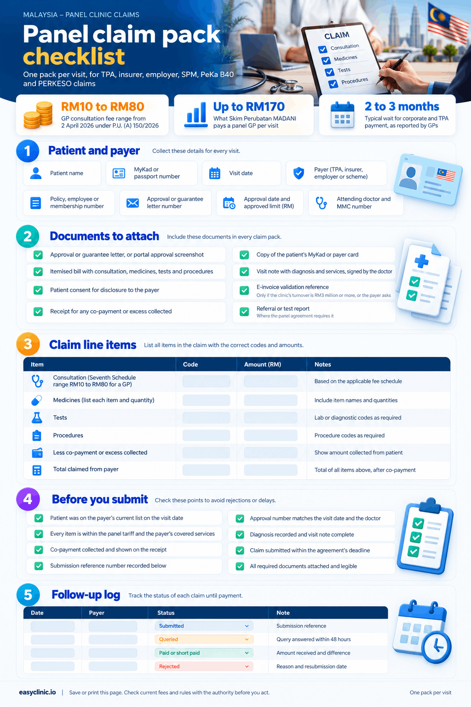

A panel clinic in Malaysia is a registered private clinic that has signed a panel agreement with a third-party administrator (TPA), an insurer, an employer or a government scheme, and then bills that payer instead of the patient. This panel clinic Malaysia guide explains how to become one and how to get paid. To join a panel, your clinic needs a current registration certificate under the Private Healthcare Facilities and Services Act 1998, a doctor with a valid annual practising certificate, a bank account in the clinic’s name, and a way to submit claims and chase them. The Malaysian Medical Association says [more than 60 percent of private GP patients](https://codeblue.galencentre.org/2025/10/maintaining-rm10-gp-fee-floor-risks-tpa-undercutting-doctors-mma/) now come through TPAs and companies, so panel work is hard to avoid. Below: the four payer types, the documents, the empanelment steps, the claims journey, the payment timelines, and where [clinic management software built for Malaysia](/emr-software-in-malaysia/) fits in.

## Panel clinic Malaysia at a glance

| **Question** | **Answer** |
| --- | --- |
| Law that governs private clinics and managed care contracts | Private Healthcare Facilities and Services Act 1998 (Act 586), Part XV on managed care organisations |
| Regulator | Ministry of Health Malaysia, [Medical Practice Division](https://moh.gov.my/en/corporate-info/division-information/medical-practice-division), which registers clinics and managed care organisations |
| Government panel schemes | Skim Perubatan MADANI (SPM) and PeKa B40, both run by [ProtectHealth Corporation](https://protecthealth.com.my/skimperubatanMadani); the PERKESO Health Screening Programme (HSP) |
| GP consultation fee range | RM10 to RM80 from 2 April 2026 under [P.U. (A) 150/2026](https://www.moh.gov.my/images/04-penerbitan/akta-kesihatan/PUA%20150%202026.pdf) |
| SPM payment to a panel GP | Fee for service, up to RM170 per visit ([ProtectHealth](https://protecthealth.com.my/skimperubatanMadani)) |
| SPM status | No allocation in Budget 2027, tabled 9 October 2026 ([CodeBlue](https://codeblue.galencentre.org/2026/10/government-abolishes-madani-medical-scheme-under-budget-2027/)) |
| TPA and MCO registry | MOH circular of 25 November 2025; MCOs had until 31 January 2026 to register ([CodeBlue](https://codeblue.galencentre.org/?p=64417)) |
| Typical wait for corporate and TPA payment | Two to three months on average, as reported by a GP; some complaints of more than six months ([CodeBlue, May 2025](https://codeblue.galencentre.org/2025/05/gp-blames-tpa-corporate-payment-delays-for-drug-price-markups/) and [November 2025](https://codeblue.galencentre.org/?p=64337)) |
| E-invoicing | Clinics with annual turnover of RM3 million or more must issue e-invoices; those below are exempt from 1 September 2026 ([LHDN](https://www.hasil.gov.my/en/e-invois/pelaksanaan-e-invois-di-malaysia/garis-masa-pelaksanaan-e-invois/)) |
| Patient data shared with payers | Personal Data Protection Act 2010, as amended in 2024, with the main amendments in force by 1 June 2025 ([DFDL](https://www.dfdl.com/insights/legal-and-tax-updates/malaysia-implementation-of-the-personal-data-protection-amendment-act-2024/)) |

## Panel clinic Malaysia payers: who covers what

Four types of payer contract a panel clinic in Malaysia: government schemes run by ProtectHealth, the PERKESO Health Screening Programme, employers who contract clinics directly, and TPAs and insurers who manage medical benefits for employers and policyholders. Each pays differently.

| **Payer** | **Who is covered** | **How the clinic is paid** | **Payment timeline** |
| --- | --- | --- | --- |
| Skim Perubatan MADANI (SPM) | Sumbangan Tunai Rahmah recipients in 10 districts, for acute minor illness | Fee for service through the PRIMIS system, capped at RM170 per visit ([ProtectHealth](https://protecthealth.com.my/skimperubatanMadani)) | Not published by ProtectHealth; ask in writing |
| PeKa B40 | STR recipients and registered spouses aged 40 and above, one free health screening | A screening fee paid by ProtectHealth; labs are paid directly ([ProtectHealth FAQ](https://protecthealth.com.my/faqs/)) | Not published; ask in writing |
| PERKESO Health Screening Programme | Insured persons aged 40 to 59 with at least 12 months of Invalidity Scheme contributions | Claims through the SEHATi portal ([PERKESO, 2025](https://www.perkeso.gov.my/images/hebahan/HSP-ProgramSaringanKesihatanPERKESO2025.pdf)) | Not published on PERKESO’s public pages |
| Corporate panels, TPAs and insurers | Employees and policyholders named on the payer’s list | Per-visit billing against a guarantee letter or portal approval, at the rate in the panel agreement | Set by the agreement; GPs report two to three months on average ([CodeBlue](https://codeblue.galencentre.org/2025/05/gp-blames-tpa-corporate-payment-delays-for-drug-price-markups/)) |

### Skim Perubatan MADANI (SPM)

SPM is an MOH scheme, run by ProtectHealth, that pays private GPs to treat acute minor illness for low-income households at no cost to the patient. Eligible patients are STR recipients in Kuala Lumpur, Gombak, Hulu Langat, Petaling, Klang, Johor Bahru, Kinta, Timur Laut in Penang, Kota Kinabalu and Kuching. Each household gets a yearly cap: RM250 for a family, RM125 for a senior citizen without a spouse, and RM75 for a single person ([ProtectHealth](https://protecthealth.com.my/skimperubatanMadani)).

The clinic is paid fee for service. ProtectHealth’s caps are RM70 for consultation and medicines together (consultation up to RM35), RM50 for tests and RM50 for procedures, so RM170 is the most a visit can earn. The list of services and fee schedule was revised on 26 May 2025, and visits before that date keep the old rates. Clinics may not charge SPM patients anything on top.

Two facts matter for planning. The scheme shrank from 21 districts to 10 on 26 February 2024, and clinics outside those districts had until 29 February 2024 to lodge late claims ([CodeBlue, 28 February 2024](https://codeblue.galencentre.org/2024/02/nationwide-madani-medical-scheme-downscaled-to-10-districts-protecthealth/)). Then the Budget 2027 documents tabled on 9 October 2026 carried no allocation for SPM, after Budget 2026 halved it from RM100 million to RM50 million ([CodeBlue, 9 October 2026](https://codeblue.galencentre.org/2026/10/government-abolishes-madani-medical-scheme-under-budget-2027/)). ProtectHealth still lists the scheme as live. If you rely on SPM income, ask ProtectHealth in writing for the last claimable visit date.

### PeKa B40

PeKa B40 pays for one free health screening per eligible person at MOH clinics and registered private clinics. It covers history taking, mental health screening, a physical examination, and blood and urine tests. It does not pay for treatment. In 2025, 328,302 people were screened, and by 31 August 2026 more than two million had been screened since April 2019, through about 5,600 private GP clinics and Klinik Kesihatan sites ([ProtectHealth, 30 September 2026](https://protecthealth.com.my/peka-b40-screenings-reveal-undiagnosed-conditions-among-almost-half-of-participants/)).

Participation is voluntary and free. ProtectHealth’s FAQ says the screening fee follows the Act 586 fee schedule, that fees are not split between clinics, and that labs are paid directly ([ProtectHealth FAQ](https://protecthealth.com.my/faqs/)). It has not published the current fee or payment cycle, so ask for both before you register.

### PERKESO Health Screening Programme

PERKESO pays panel clinics to screen insured workers aged 40 to 59 with at least 12 months of Invalidity Scheme contributions who have not been screened in the current round. The 2025 round covered a physical examination, mental health screening, counselling, a full blood count, HbA1c, fasting lipids and urine FEME, plus a Pap smear and mammogram for women ([PERKESO, 2025](https://www.perkeso.gov.my/images/hebahan/HSP-ProgramSaringanKesihatanPERKESO2025.pdf)). Clinics apply through the Panel Application menu on the programme portal and then manage bookings and claims on the SEHATi portal ([PERKESO portal guide](https://www.perkeso.gov.my/images/imej/panduan_online/HSP%20Portal%20Guideline.pdf)). PERKESO has not published the per-screening fee on its public pages, so confirm it when you apply.

### Corporate panels, TPAs and insurers

This is where most TPA panel clinic income comes from. An employer can contract your clinic directly and pay against monthly invoices. More often the employer or insurer appoints a TPA, also called a managed care organisation (MCO), which holds the panel agreement, checks entitlement, approves the visit and pays the clinic. MMA told the press in October 2025 that TPAs and companies often paid panel GPs below RM35 a consultation, while one TPA said it paid panel GPs an average of RM134 a visit, of which RM34 was consultation and RM100 was medicines ([CodeBlue, August 2026](https://codeblue.galencentre.org/2026/08/mma-slams-insurers-rm50-limit-for-gp-visits/)). The rate you get depends on the agreement you sign, so read the tariff annex before anything else.

## How can a private clinic accept insurance in Malaysia

A private clinic accepts insurance in Malaysia by joining the panel of each TPA, insurer or employer scheme it wants to bill, one agreement at a time. There is no single national panel for private insurance. Each payer runs its own credentialing, tariff, portal and payment cycle, while the clinic’s Act 586 registration, the doctor’s APC and the Seventh Schedule fee limits apply to all of them.

### The rules that bind every panel agreement

Part XV of Act 586 governs managed care. Section 82 defines a managed care organisation, section 83 bars any contract that alters a doctor’s clinical powers or breaches the Act or professional ethics, section 85 lets the Director General demand information from MCOs, and section 86 sets up the MCO registry ([CodeBlue, 29 November 2025](https://codeblue.galencentre.org/?p=64417)). On 25 November 2025 the Director General of Health ordered every MCO and TPA dealing with private facilities to submit its company details and its contracts with clinics by 31 January 2026. Non-compliance is an offence under section 85, with a fine of RM100,000 to RM300,000, up to two years in prison, or both. Before you sign, ask the TPA for its MOH registration number.

On 2 July 2026 MOH warned MCOs and TPAs that interfering with a doctor’s clinical practice may be inconsistent with the law, and said their role is to facilitate financial and claims administration, not to regulate medicine ([CodeBlue, 2 July 2026](https://codeblue.galencentre.org/?p=72019)). There is still no standalone Act for TPAs, and lawmakers and at least one TPA have called for one that would set provider payment terms ([CodeBlue, 27 November 2025](https://codeblue.galencentre.org/?p=64337)).

The Malaysian Medical Council’s position paper on managed care, adopted on 20 June 2023, adds the professional side: no fee-splitting or kickbacks for referrals, written patient consent before records go to an insurer, MCO or employer, and the same fee computation for cashless, pay-and-file and cash patients. MCOs must give a doctor a reminder and a chance to respond before removing them from a cashless panel ([MMC position paper](https://mmc.gov.my/wp-content/uploads/2025/09/MMC-Position-Paper-on-Managed-Care.pdf)).

### The 2026 consultation fee order and what TPAs did with it

The Amendment of Fee Schedule Order 2026, P.U. (A) 150, was gazetted on 31 March 2026 and took effect on 2 April 2026. It sets the GP consultation fee at RM10 to RM80, specialist first visits at RM80 to RM235 and specialist follow-ups at RM40 to RM105, with up to 50 percent more after clinic hours and up to 100 percent more for house calls ([P.U. (A) 150/2026](https://www.moh.gov.my/images/04-penerbitan/akta-kesihatan/PUA%20150%202026.pdf)). It was the first change to the GP range in about 30 years ([Malay Mail, 3 April 2026](https://www.malaymail.com/news/malaysia/2026/04/03/private-gps-welcome-revised-rm10rm80-consultation-fee-after-30-year-freeze/214926)).

The order sets the legal range. It does not force a TPA to pay the top of it. The Federation of Private Medical Practitioners’ Associations said the real effect would depend on implementation within managed care and TPA arrangements, where prices are not fully market-driven. MMA had asked for a RM50 floor to stop undercutting and was refused ([CodeBlue, 10 October 2025](https://codeblue.galencentre.org/2025/10/maintaining-rm10-gp-fee-floor-risks-tpa-undercutting-doctors-mma/)). In August 2026 MMA criticised a new insurance plan that capped GP consultation and medicines together at RM50 a visit ([CodeBlue, 10 August 2026](https://codeblue.galencentre.org/2026/08/mma-slams-insurers-rm50-limit-for-gp-visits/)). The practical point: your panel tariff is a contract term. If the TPA has not revised it since 2 April 2026, ask for a revision in writing and keep the reply.

### Bank Negara’s cost measures and what they mean at the front desk

Bank Negara Malaysia regulates insurers and takaful operators, not clinics, but its rules change what patients bring to your counter. From 1 September 2024 insurers must offer medical plans with a co-payment option, capped, with no co-payment on emergency care or at government facilities ([Bank Negara Malaysia, 6 July 2024](https://www.bnm.gov.my/-/mhit-req-en)). On 20 December 2024 it added interim measures that spread premium rises over at least three years until the end of 2026, and a RM60 million fund with the government, insurers and private hospitals for a diagnosis-related group payment model and a base medical plan ([Bank Negara Malaysia](https://www.bnm.gov.my/-/mhit-pr)). The base plan is due to pilot in the second half of 2026 and roll out in early 2027 ([Ministry of Finance, 22 January 2026](https://mof.gov.my/portal/en/news/speech/jbmkks-joint-ministers-statements-press-briefing)), and a MediAsas plan for middle-income Malaysians is due in January 2027 ([Bernama, 18 October 2026](https://bernama.com/bm/news.php?id=2621985)).

For a panel clinic Malaysia wide, this means more co-payments to collect at the visit, more plans with low GP caps, and more questions about cover. Your front desk needs the payer’s rules before the consultation, not after.

## Documents for insurance empanelment in Malaysia

The documents for insurance empanelment in Malaysia are the same core set for every payer, with a few extras for government schemes. Most of them come out of the clinic registration process described in our guide to [opening a clinic in Malaysia](/clinic-in-malaysia/). ProtectHealth lists its requirements in public, so the table below uses them as the base and adds what TPAs and insurers commonly ask for.

| **Document** | **Why the payer wants it** | **Where it comes from** |
| --- | --- | --- |
| Clinic registration certificate (Borang B for a medical clinic, Borang F for a dental clinic) | Proves the clinic is registered under Act 586; SPM requires registration in the name of the person in charge ([ProtectHealth](https://protecthealth.com.my/skimperubatanMadani)) | MOH, through the Act 586 registration process; the application uses Borang A with a RM500 processing fee ([MOH checklist, 30 August 2022](https://hq.moh.gov.my/medicalprac/wp-content/uploads/2022/10/2_Senarai-Semak-Doc-Perubatan-Ogos-22.pdf)) |
| Full MMC registration certificate of the person in charge | Confirms the doctor is registered under the Medical Act 1971 | Malaysian Medical Council |
| Current annual practising certificate (APC) | Confirms the doctor may practise this year; expect to supply a fresh copy each year it renews | Malaysian Medical Council |
| Proof of a clinic or company bank account | Payments go to the clinic, never to a personal account; SPM rejects personal accounts ([ProtectHealth](https://protecthealth.com.my/skimperubatanMadani)) | Your bank |
| SSM registration or company profile | Confirms the legal entity that signs the agreement | Companies Commission of Malaysia |
| Signed letter of appointment or panel agreement | The contract that sets tariffs, credit terms and termination rules | The payer |
| Declared list of extra services, such as X-ray with a valid Atomic Energy Licensing Board licence | SPM requires added services to be declared and licensed at registration ([ProtectHealth](https://protecthealth.com.my/skimperubatanMadani)) | The relevant licensing body |
| Clinic operating hours, services and doctor roster | Printed on the panel listing and used to match guarantee letters | Your clinic |
| Tax identification number and e-invoice status | Needed by payers that issue or receive e-invoices under the LHDN rollout | LHDN |

Keep the set as scanned PDFs in one folder with a renewal date on each, because the APC and the clinic registration both expire and a payer can suspend a clinic whose documents lapse. For each claim, use the pack below. Save the image or rebuild it in your form builder.

***Sample 1:** panel claim pack checklist with patient and payer details, documents to attach, claim line items, a pre-submission check and a follow-up log.*

## How to join a panel, step by step

### ProtectHealth schemes through PRIMIS

ProtectHealth publishes the SPM empanelment route in full ([ProtectHealth](https://protecthealth.com.my/skimperubatanMadani)). PeKa B40 uses a separate provider registration at ProtectHealth’s BMS portal, and a clinic with both BMS and VCS credentials may use either to join SPM.

1. **Check that you qualify.** The clinic must be registered as a general private medical clinic. Specialist clinics are excluded. You need a telephone line, internet, a computer and a printer.
2. **Register on the PRIMIS Provider Portal** and upload the Borang B or F certificate, the MMC certificate and APC of the person in charge, and proof of the clinic bank account.
3. **Get the Letter of Appointment from the portal** once the approval email arrives, sign it and upload it for verification.
4. **Pass the onboarding assessment.** Ten online questions, an 80 percent pass mark, and you may retry.
5. **Go live** when your status shows Active, then open the PRIMIS Clinical Portal to record visits and claims. The fee schedule and list of services sit under Provider Resources on the portal.

### PERKESO Health Screening Programme panel application

1. **Open the programme portal** and choose Panel Application, then HSP Panel Clinic ([PERKESO portal guide](https://www.perkeso.gov.my/images/imej/panduan_online/HSP%20Portal%20Guideline.pdf)).
2. **Complete the application** and submit it online.
3. **Activate your SEHATi portal account** once approved. That is where you confirm eligibility, record screenings and claim ([PERKESO, 2025](https://www.perkeso.gov.my/images/hebahan/HSP-ProgramSaringanKesihatanPERKESO2025.pdf)).
4. **Ask PERKESO for the current fee and payment cycle in writing** before your first screening, because neither is on the public pages.

### TPA panel clinic agreements, insurers and corporate panels

1. **List the payers your patients already carry.** Have the front desk note every insurer, TPA or employer card for a month, then apply to the payers you see most.
2. **Request the panel application and the tariff annex.** Read the annex for the consultation rate, medicine pricing rules, exclusions, the credit term in days and the administrative deduction, if any.
3. **Confirm the TPA is on MOH’s MCO registry.** Ask for the registration number issued after the 25 November 2025 circular ([CodeBlue](https://codeblue.galencentre.org/?p=64417)).
4. **Submit the document set** from the table above, with the signed agreement.
5. **Set up portal access and the guarantee letter process.** Agree who in your clinic logs in to verify patients, and what happens when an approval fails.
6. **Load the payer rules into your clinic system** before the first panel patient: tariff, covered services, exclusions and limits. A system that holds [payer profiles, coverage rules and claim validation](/payor-management/) stops most rejections before they happen.
7. **Diarise renewals.** Note the agreement’s term, its notice period and the date each APC expires, and set reminders a month ahead.

## The panel clinic Malaysia claims journey, and what goes wrong

A panel claim fails at predictable points. The table below follows one visit from the counter to the bank.

| **Stage** | **What should happen** | **What goes wrong** |
| --- | --- | --- |
| 1\. Check entitlement | Front desk confirms the patient on the payer’s portal or SPM check, and records the approval or guarantee letter number | The patient is not on the current list, the yearly cap is used up, or the employer changed TPA last month |
| 2\. Consult and record | The doctor records the diagnosis, services, medicines and quantities, and the visit date | Diagnosis missing, medicine not on the payer’s list, or a service the plan excludes |
| 3\. Price the visit | The bill follows the panel tariff and the Seventh Schedule range | Consultation billed above the agreed rate, or a procedure coded under the wrong item |
| 4\. Collect the patient share | Co-payment or excess collected at the counter and shown on the receipt | Co-payment forgotten, so the clinic absorbs it |
| 5\. Submit the claim | Claim sent through the portal or PRIMIS with the approval reference, within the agreement’s deadline | Submitted late, missing the guarantee letter number, or sent for a patient treated outside the covered districts |
| 6\. Track and chase | Claim status checked weekly; queries answered within the payer’s window | Query email missed, claim marked unpaid for months, or the payer says the invoice never arrived |
| 7\. Reconcile | Payment matched to each claim; short payments disputed in writing | Bulk payment booked as income without matching, so deductions go unnoticed |

### Guarantee letters and approvals

The MOH managed care guideline, as summarised by the MMC, describes insurers acting through letters of guarantee and TPAs managing employee medical benefits ([MMC position paper](https://mmc.gov.my/wp-content/uploads/2025/09/MMC-Position-Paper-on-Managed-Care.pdf)). The guarantee letter, or the electronic approval that replaces it, is the payer’s promise to pay for that visit within its limits. Record its reference on the visit, keep a copy with the claim, and do not treat a panel patient on credit without one unless the agreement allows it.

### E-invoicing and panel claims

LHDN’s e-invoice rollout reached taxpayers with annual turnover up to RM5 million on 1 January 2026. From 1 September 2026 the exemption threshold rose, so businesses with annual turnover below RM3 million no longer need to issue e-invoices, which LHDN says covers more than 1.1 million businesses ([LHDN timeline](https://www.hasil.gov.my/en/e-invois/pelaksanaan-e-invois-di-malaysia/garis-masa-pelaksanaan-e-invois/) and [The Star, 30 August 2026](https://thestar.com.my/news/nation/2026/08/30/over-11-million-businesses-to-benefit-from-higher-e-invoicing-threshold-says-lhdn)). If your clinic is above the threshold, each panel invoice to a TPA, insurer or employer is a business-to-business sale that needs a validated e-invoice through the MyInvois system, and a payer can hold a claim until it gets one. If you are below it, a large payer may still ask you to issue e-invoices voluntarily, so ask each payer what it needs.

## How long do insurance claims take to pay clinics in Malaysia

Insurance claims take two to three months on average to pay a private clinic in Malaysia, according to a GP interviewed in May 2025, with some invoices outstanding for one to two years ([CodeBlue, 27 May 2025](https://codeblue.galencentre.org/2025/05/gp-blames-tpa-corporate-payment-delays-for-drug-price-markups/)). In November 2025 the head of one TPA said providers had complained that other TPAs had not paid claims for more than six months, and called for an Act that sets payment terms ([CodeBlue, 27 November 2025](https://codeblue.galencentre.org/?p=64337)). No law currently fixes a payment deadline for TPAs or insurers, so the credit term in your panel agreement is the only promise you hold.

| **Payer** | **What sets the timeline** | **What to do** |
| --- | --- | --- |
| TPA or insurer | The credit term in the panel agreement, counted from a complete claim | Write the term into your follow-up log and chase on the day it lapses |
| Employer paying directly | Your own invoice terms | Invoice monthly, state a due date, and stop credit when two months are unpaid |
| SPM through PRIMIS | ProtectHealth’s internal cycle; not published | Ask ProtectHealth for the cycle in writing and check PRIMIS weekly |
| PeKa B40 | ProtectHealth’s internal cycle; not published | Same as above |
| PERKESO HSP | PERKESO’s internal cycle; not published | Ask PERKESO before the first screening |

Three habits shorten the wait for a panel clinic Malaysia payers deal with. Submit within days of the visit, not at month end, because a claim cannot be paid before it is received. Answer payer queries within 48 hours, because a queried claim sits outside the payment run. Reconcile every remittance against claims, because short payments and silent rejections are where clinics lose money. Clinics in Kenya face the same discipline under the Social Health Authority, as our [guide to starting a clinic in Kenya](/the-ultimate-guide-to-starting-a-clinic-in-kenya/) shows, and telehealth visits add their own rules, covered in our [telemedicine in India 2026](/telemedicine-in-india-2026/) guide.

## Common mistakes

- **Signing the tariff annex without reading it.** The consultation rate, medicine pricing rule and administrative deduction decide whether the panel pays. MMA’s warning about undercutting is about this page of the contract ([CodeBlue](https://codeblue.galencentre.org/2025/10/maintaining-rm10-gp-fee-floor-risks-tpa-undercutting-doctors-mma/)).
- **Treating a panel patient without an approval reference.** If the employer removed the patient from its list, the claim has no payer.
- **Letting the APC or clinic registration lapse.** Panels suspend clinics with expired documents, and claims lodged in the gap are rejected.
- **Billing the old SPM rate.** The list of services and fee schedule changed on 26 May 2025, and the PRIMIS portal holds the current version ([ProtectHealth](https://protecthealth.com.my/skimperubatanMadani)).
- **Charging an SPM patient a top-up.** ProtectHealth bars extra charges to SPM beneficiaries.
- **Sending patient records to a payer without consent.** The MMC requires informed written consent before disclosure to insurers, MCOs or employers, limited to payment matters ([MMC](https://mmc.gov.my/wp-content/uploads/2025/09/MMC-Position-Paper-on-Managed-Care.pdf)). The PDPA amendments in force from 1 April and 1 June 2025 raised the maximum fine for breaching the data protection principles to RM1 million and made breach notification mandatory ([DFDL](https://www.dfdl.com/insights/legal-and-tax-updates/malaysia-implementation-of-the-personal-data-protection-amendment-act-2024/)). Clinics in other markets face the same duty under the [Kenya Data Protection Act](/data-privacy-laws-in-kenya/) and [India’s DPDP Act](/patient-data-privacy-laws-in-india/).
- **Keeping claims on paper.** A payer that says the invoice never arrived can only be answered with a submission record and reference number.
- **Depending on one scheme.** SPM went from 21 districts to 10 in 2024, a halved budget in 2026 and no allocation for 2027. Spread panel income across payers.
- **Ignoring the 2026 fee order.** If your tariff still reflects the RM35 ceiling, the TPA is paying under a schedule that no longer exists. Ask for a revision ([U. (A) 150/2026](https://www.moh.gov.my/images/04-penerbitan/akta-kesihatan/PUA%20150%202026.pdf)).

## How Easy Clinic fits in

Panel clinic Malaysia work is a records problem before it is a billing problem: the payer, the approval reference, the covered services and the tariff all need to sit on the visit before the claim leaves. Easy Clinic’s [payor management](/payor-management/) lets you set up each insurer or corporate payer with its billing rates, contract terms and coverage, link patients to their payer at registration, and generate invoices from those rules so uncovered services are caught before submission. The [Malaysia EMR software page](/emr-software-in-malaysia/) covers ringgit invoicing with card, bank transfer, FPX and DuitNow payment, Malay and English records and PDPA-aligned access controls; see the full [feature list](/features/) and current plans on the [pricing page](/pricing/).

## Related guides

- [How to open a clinic in Malaysia](/clinic-in-malaysia/)
- [The complete guide to starting a clinic in Kenya](/the-ultimate-guide-to-starting-a-clinic-in-kenya/)
- [Data privacy laws for clinics in Kenya](/data-privacy-laws-in-kenya/)
- [Patient data privacy laws in India](/patient-data-privacy-laws-in-india/)
- [Telemedicine in India in 2026](/telemedicine-in-india-2026/)
- [ABDM compliance for clinics in India](/abdm-compliance/)

## Panel clinic Malaysia: common questions

### What is a panel clinic in Malaysia?

A panel clinic Malaysia payers recognise is a registered private clinic that has signed an agreement with a payer, such as a TPA, an insurer, an employer or a government scheme like Skim Perubatan MADANI, and bills that payer for covered visits instead of the patient.

### How can a private clinic accept insurance in Malaysia?

By applying to each TPA, insurer or employer scheme separately with the clinic’s Act 586 registration certificate, the doctor’s MMC registration and APC, the clinic bank account details and a signed panel agreement, then billing through that payer’s portal or guarantee letter process.

### Which documents are needed for insurance empanelment in Malaysia?

The core set is the Borang B or F clinic registration certificate, the person in charge’s full MMC registration certificate and current APC, proof of a clinic or company bank account, the SSM company profile, and the signed panel agreement. Government schemes add a declaration of extra services and licences such as the X-ray licence.

### How long do insurance claims take to pay clinics in Malaysia?

Two to three months on average, according to a GP interviewed in May 2025, with some complaints of more than six months. No law fixes a payment deadline, so the credit term in the panel agreement governs.

### How much does Skim Perubatan MADANI pay a panel GP?

Fee for service through PRIMIS, capped at RM70 for consultation and medicines together, RM50 for tests and RM50 for procedures, so a maximum of RM170 a visit, under the fee schedule revised on 26 May 2025.

### Is Skim Perubatan MADANI still running in 2026?

ProtectHealth still lists it, but Budget 2027, tabled on 9 October 2026, carries no allocation for it, after the 2026 budget was halved to RM50 million. Ask ProtectHealth in writing for the last claimable date.

### Can a TPA pay less than the RM10 to RM80 consultation range?

The 2026 fee order sets the legal range for what a clinic may charge, and RM10 is still the floor. MMA has said TPAs often paid below RM35 and asked for a RM50 floor, which the government declined, so the rate you get is the one in your panel agreement.

### Are TPAs regulated in Malaysia?

Partly. Managed care organisations fall under Part XV of Act 586, and MOH ordered all MCOs and TPAs to register by 31 January 2026, with fines of RM100,000 to RM300,000 for non-compliance. There is no standalone TPA Act yet.

### Does my clinic need to issue e-invoices for panel claims?

Only if your annual turnover is RM3 million or more. From 1 September 2026 businesses below that threshold are exempt, though a large payer may still ask you to issue e-invoices voluntarily.

### Can I charge an SPM or PeKa B40 patient a top-up?

No. ProtectHealth bars extra charges to SPM beneficiaries for covered care, and PeKa B40 screening is free to the patient.

This guide is general information, not legal or tax advice. Confirm current rules with the Ministry of Health Malaysia.
