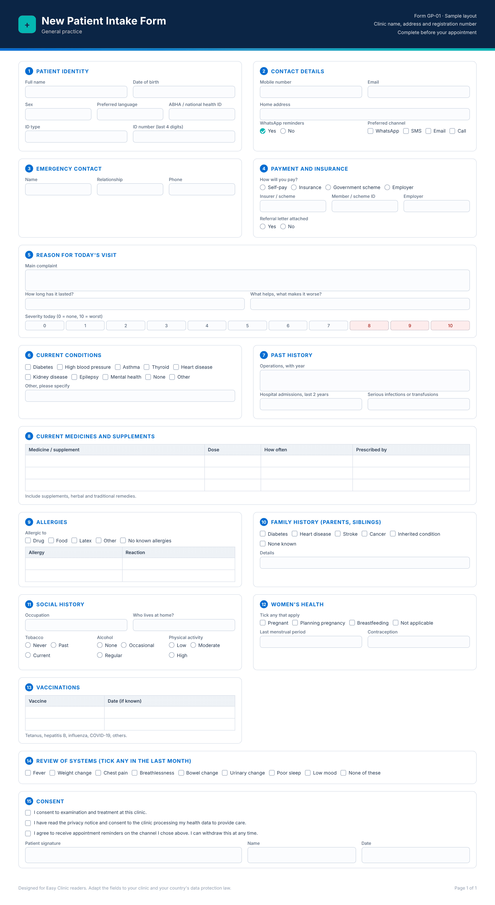
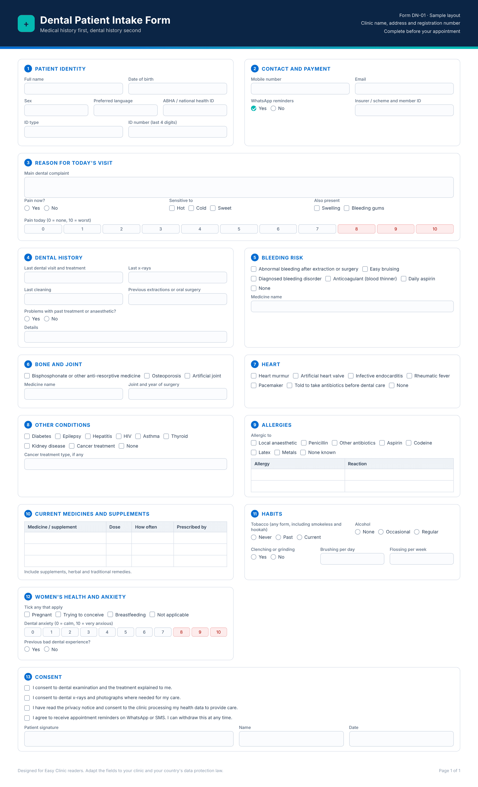
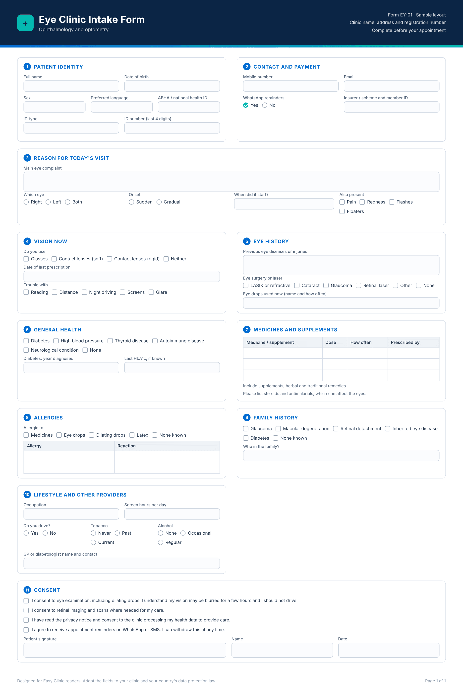
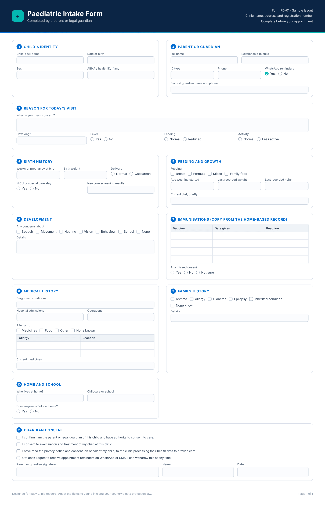

Good patient intake forms collect six things before the doctor walks in: who the patient is, how to reach them, why they came, what they already take, what they react to, and what they agree to. Everything else depends on the specialty. A dental form asks about bleeding and bisphosphonates. An eye clinic asks about glasses and glaucoma in the family. A physiotherapy form asks about work demands and goals. A paediatric form asks about birth, growth and immunisations. This guide gives you five designed sample forms with their field lists, a master field list, the consent rules for India, Kenya, Nigeria, Malaysia and the UAE, and a plan to move intake online. You can rebuild any of them with [Easy Clinic’s custom intake forms](/features/).

## Patient intake forms at a glance

| **Question** | **Answer** |
| --- | --- |
| Core sections every form needs | Identity, contact and emergency contact, payer details, reason for visit, medical history, medications, allergies, family and social history, consent |
| What to leave out | Anything you will not use for care, billing or a legal duty. Data minimisation is written into the law in every market below |
| India: law and authority | [Digital Personal Data Protection Act, 2023](https://www.meity.gov.in/static/uploads/2024/06/2bf1f0e9f04e6fb4f8fef35e82c42aa5.pdf) and the DPDP Rules, 2025, enforced by the Data Protection Board of India. Most duties start on 13 May 2027 |
| India: child’s form | Verifiable consent of a parent or lawful guardian for anyone under 18, with a limited exemption for clinical establishments providing health services |
| India: ID field | ABHA number, a voluntary 14-digit health ID under ABDM |
| Kenya: law and authority | [Data Protection Act, 2019](https://www.odpc.go.ke/wp-content/uploads/2024/02/TheDataProtectionAct__No24of2019.pdf), Office of the Data Protection Commissioner (ODPC). Health status is sensitive personal data |
| Nigeria: law and authority | Nigeria Data Protection Act, 2023, Nigeria Data Protection Commission (NDPC). Health status is sensitive personal data |
| Malaysia: law and authority | Personal Data Protection Act 2010, amended by Act A1727 in 2024, Personal Data Protection Commissioner. Breach of the principles can cost up to RM1,000,000 |
| UAE: law and authority | Federal Law No. 2 of 2019 on ICT in health fields, the Ministry of Health and Prevention and the emirate health authorities. Health data stays in the UAE |
| Evidence for digital intake | Tablet questionnaires in clinic cut missing data from 32% to 2% in one Dutch study; a Korean paediatric clinic raised history completeness from 54.6% to 99.3% |
| Downloads | None yet. Copy the tables below into your own form builder |

## What to include in a patient intake form

A patient intake form should include the patient’s identity, contact details, an emergency contact, payer details, the reason for the visit, medical and surgical history, current medications, allergies, family and social history, and consent. That list matches what professional bodies ask clinicians to record. The American Academy of Ophthalmology’s [Preferred Practice Pattern](https://aao.org/Assets/b1c26427-8684-41bb-b287-5c501f6d4e4d/637454462239970000/comprehensive-adult-medical-eye-evaluation-ppp-pdf) (2020) lists demographic data, chief complaint, systemic history, medications, allergies, family history and social history. Ontario’s [physiotherapy record keeping standard](https://collegept.org/standard/record-keeping-standard) (1 August 2025) requires the “patient’s relevant health, family, and social history” and “documentation of informed consent”. India’s [EHR Standards](https://esanjeevani.mohfw.gov.in/assets/guidelines/ehr_guidlines.pdf) (MoHFW, 2016) call for a general consent for treatment, payment and healthcare operations, and a specific consent for anything else.

Use this master table to build any medical history form. The specialty templates add to it; they do not replace it.

| **Section** | **Fields** | **Why it matters** |
| --- | --- | --- |
| Identity | Full name, date of birth, sex, preferred language, national or health ID number (ABHA in India, SHA Health ID in Kenya), photo ID type | Prevents duplicate records and wrong-patient errors. India’s EHR Standards ask for at least two identifiers when Aadhaar is not used |
| Contact | Mobile number, WhatsApp consent, email, home address, preferred contact channel | Reminders and results go nowhere without it. Ask once which channel the patient prefers |
| Emergency contact | Name, relationship, phone | Needed in an emergency and for consent when the patient cannot speak for themselves |
| Payer | Self-pay, insurer name, policy or member number, scheme ID, employer, pre-authorisation reference | Claims fail on a wrong member number. Collect it before the visit, not after |
| Reason for visit | Main complaint in the patient’s words, when it started, what makes it better or worse | The doctor’s starting point. Keeps the consultation focused |
| Medical and surgical history | Diagnosed conditions, past operations, hospital admissions in the last two years, pregnancies if relevant | Flags risks before examination or treatment |
| Medications | Every current medicine with dose and frequency, including over-the-counter, herbal and supplements | Interaction and dosing safety. Supplements are the most forgotten item |
| Allergies | Drug, food, latex and other allergies, with the reaction | Protects against a preventable harm |
| Family history | Conditions in parents and siblings relevant to the specialty | Guides screening and risk |
| Social history | Occupation, tobacco, alcohol, living situation | Affects treatment plans and follow-up |
| Consent and notice | Consent to treatment, consent to data processing with the privacy notice, consent to reminders by WhatsApp or SMS, signature and date | Required by law in every market below. Keep a verifiable record |

### What to leave out

Collect only what you will use. Kenya’s Data Protection Act section 25 requires personal data to be “limited to what is necessary in relation to the purposes for which it is processed”. Nigeria’s Act section 24 says the same. India’s DPDP Act section 6 limits consent to the personal data “necessary for such specified purpose”. In practice that means no religion, caste, marital status or income fields unless a scheme or law requires them, no full copies of ID documents, and no marketing opt-ins buried in the consent block.

## Consent and data rules by market

The consent block is where most legal risk sits. Each market treats health data as a special category and expects a notice, a clear consent, and extra care for children. Confirm the detail with the named regulator.

| **Market** | **What the law calls health data** | **Notice and consent on the form** | **Children** | **Regulator** |
| --- | --- | --- | --- | --- |
| India | Personal data under the DPDP Act, 2023. The Act applies to digital personal data | Section 5 requires a notice before or with the consent request. Section 6 requires consent that is “free, specific, informed, unconditional and unambiguous with a clear affirmative action” | Section 9: verifiable consent of the parent or lawful guardian for anyone under 18. [Rule 10](https://www.scconline.com/blog/post/2025/11/14/meity-notified-digital-personal-data-protection-rules-2025/) sets how to verify. The Fourth Schedule exempts clinical establishments and healthcare professionals from the consent duty when processing is limited to providing health services to the child | Data Protection Board of India |
| Kenya | “Health status” is sensitive personal data under section 2 of the Data Protection Act, 2019 | Section 29 requires you to tell the patient why you collect the data, who receives it and whether giving it is voluntary. The [ODPC guidance note](https://www.odpc.go.ke/wp-content/uploads/2024/02/ODPC-Guidance-Note-on-Processing-of-Health-Data.pdf) (December 2023) says consent must be explicit, specific and easy to revoke, with a verifiable record | Section 33: consent of a parent or guardian, with age verification | ODPC. The guidance note says all healthcare entities must register |
| Nigeria | “Health status” is sensitive personal data under the [Nigeria Data Protection Act, 2023](https://www.dataguidance.com/sites/default/files/data_protection_act_2023.pdf) | Section 27 lists what to tell the patient before collection. Section 26 puts the burden of proving consent on the clinic, and silence or a pre-ticked box does not count. Section 30 allows health processing by a professional owing a duty of confidentiality | Section 31: consent of the parent or legal guardian, with age and consent verification | NDPC |
| Malaysia | “Physical or mental health or condition” is sensitive personal data under the PDPA 2010, with biometric data added from 1 April 2025 | Explicit consent is the general rule for sensitive personal data, and a written notice must be given, as summarised in this [2025 law guide](https://www.globallegalpost.com/lawoverborders/data-protection-law-guide-1072382791/malaysia-1020843780) | Under 18: consent from a parent, guardian or person with parental responsibility | Personal Data Protection Commissioner |
| UAE | Health data falls under Federal Law No. 2 of 2019, and the federal PDPL excludes health data that has its own law, as [K&L Gates](https://www.klgates.com/thought-leadership/New-UAE-Federal-Data-Protection-Law-2-10-2022) explains | Patient consent is generally required for disclosure, and data must stay in the UAE unless an exemption applies, as [Taylor Wessing](https://www.taylorwessing.com/en/insights-and-events/insights/2021/08/me-health-data-in-the-uae-how-the-health-data-law-works-what-it-protects-and-what-exemptions-exist) summarises | No specific intake rule found at federal level. Ask your licensing authority (DHA or DoH) whether it sets its own rule for consent on behalf of minors | MOHAP, DHA, DoH |

Three dates matter for Indian clinics. MeitY notified the DPDP Rules on 13 November 2025. Consent manager rules start on 13 November 2026. Most other rules, including the notice, children’s consent and the Fourth Schedule exemption, start on 13 May 2027. Our guide to [patient data privacy laws in India](/patient-data-privacy-laws-in-india/) covers the timeline. Kenyan clinics should read our guide to [data privacy laws in Kenya](/data-privacy-laws-in-kenya/) before changing consent wording on patient intake forms.

Malaysia’s [Amendment Act A1727](https://www.pdp.gov.my/ppdpv1/wp-content/uploads/2024/11/Act-A1727.pdf), gazetted on 17 October 2024, raised the penalty for breaching the data protection principles to RM1,000,000, three years in prison, or both, and made failing to notify the Commissioner of a breach an offence with a fine of up to RM250,000. In the UAE, breaching the localisation rule can cost AED 500,000 to AED 700,000 under the 2019 health data law, and records must be kept for at least 25 years from the last procedure.

## Patient intake form template for clinics: general practice

A general practice patient intake form template needs the master list above plus a short review of systems and a vaccination check. It doubles as the new patient registration form, so the patient signs in once. Copy this table into your form builder.

| **Section** | **Fields** | **Why it matters** |
| --- | --- | --- |
| Identity | Full name, date of birth, sex, preferred language, ABHA or national health ID, ID type and last four digits | Matches the patient to one record. India’s ABDM Scan and Share lets a patient share name, age, gender and ABHA from their phone so the counter does not retype it |
| Contact | Mobile, WhatsApp yes or no, email, address, preferred channel | Reminders and recalls |
| Emergency contact | Name, relationship, phone | Emergencies and consent |
| Payer | Self-pay, insurer and member number, scheme ID, employer, referral letter attached | Claims and pre-authorisation |
| Reason for visit | Main complaint, duration, severity 0 to 10, what helps, what worsens | Sets the agenda |
| Current conditions | Diabetes, hypertension, asthma, thyroid, heart disease, kidney disease, epilepsy, mental health, other | Risk and prescribing |
| Past history | Operations with year, hospital admissions in the last two years, serious infections, transfusions | Risk and prescribing |
| Medications | Name, dose, frequency, prescriber, plus supplements and traditional remedies | Interactions |
| Allergies | Drug, food, latex, other, with the reaction | Safety |
| Family history | Diabetes, heart disease, stroke, cancer, inherited conditions in parents and siblings | Screening |
| Social history | Occupation, tobacco, alcohol, physical activity, who lives at home | Treatment planning |
| Women’s health | Pregnant or planning, breastfeeding, last menstrual period, contraception | Prescribing safety |
| Vaccinations | Tetanus, hepatitis B, influenza, COVID-19, others, with dates where known | Preventive care |
| Review of systems | Tick boxes for fever, weight change, chest pain, breathlessness, bowel or urinary change, sleep, mood | Catches what the complaint misses |
| Consent | Treatment consent, privacy notice read, data processing consent, reminder channel consent, signature, date | Legal duty in every market |

***Sample 1:** general practice patient intake form built from the table above. Save the image or rebuild it in your form builder.*

## Digital intake forms for specialty clinics

Digital intake forms for specialty clinics start from the general practice template and add the questions that change what the clinician does. The four templates below cover dental, eye, physiotherapy and paediatric intake, and each adds rows to the master table rather than repeating it.

### Dental intake form template: a medical history form first

Dental intake is a medical history form first and a dental questionnaire second. The [University of Nebraska College of Dentistry form](https://www.unmc.edu/dentalservices/wp-content/uploads/2024/01/med_history_form.pdf) (2024) shows why: it asks about antibiotic premedication, anticoagulants, bisphosphonates, abnormal bleeding after extractions, artificial joints and heart valves, and allergies to local anaesthetics and latex. Each one changes what a dentist can safely do.

| **Section** | **Fields** | **Why it matters** |
| --- | --- | --- |
| Reason for visit | Main dental complaint, pain now (yes or no, 0 to 10), sensitivity to hot or cold, swelling, bleeding gums | Decides urgency and the first examination |
| Dental history | Last visit and what was done, last x-rays, last cleaning, previous extractions or oral surgery, problems with past treatment or anaesthetic | Avoids repeat imaging and surprises |
| Bleeding risk | Abnormal bleeding after extractions or surgery, easy bruising, bleeding disorder, anticoagulant or daily aspirin use | Extractions and surgery planning |
| Bone and joint | Bisphosphonate or other anti-resorptive use, artificial joint and year, osteoporosis | Jaw complications and premedication decisions |
| Heart | Heart murmur, artificial valve, infective endocarditis, rheumatic fever, pacemaker, advised to take antibiotics before dental care | Premedication and safety |
| Other conditions | Diabetes, epilepsy, hepatitis, HIV, asthma, thyroid, kidney disease, cancer treatment and type | Treatment planning |
| Allergies | Local anaesthetic, penicillin, other antibiotics, aspirin, codeine, latex, metals, with the reaction | Chair-side safety |
| Habits | Tobacco including smokeless and hookah, alcohol, clenching or grinding, brushing and flossing frequency | Prevention and periodontal risk |
| Women’s health | Pregnant, trying to conceive, breastfeeding | Imaging and prescribing |
| Anxiety | Dental anxiety 0 to 10, previous bad experience | Sedation and appointment length |
| Consent | Treatment consent, imaging consent, privacy notice, reminder channel, signature | Legal duty |

***Sample 2:** dental intake form. The medical alerts sit before the dental questions so the dentist sees them first.*

Clinics running the form inside a [dental EMR](/dental-emr-software/) can attach it to the patient’s chart so the medical alerts show before every appointment.

### Eye clinic intake form template

The AAO’s 2020 Preferred Practice Pattern lists what an eye history should hold: present visual function and eyeglass or contact lens use, ocular symptoms, prior eye diseases, injuries and surgeries including refractive surgery, ophthalmic and systemic medications, allergies, family eye disease such as glaucoma and macular degeneration, and social history including occupation. Build those into the patient intake form so the optometrist or ophthalmologist starts with the answers.

| **Section** | **Fields** | **Why it matters** |
| --- | --- | --- |
| Reason for visit | Main eye complaint, which eye, onset, sudden or gradual, pain, redness, flashes or floaters | Triage of urgent presentations |
| Vision now | Glasses, contact lenses and type, last prescription date, trouble with reading, distance, night driving or screens | Refraction planning |
| Eye history | Previous eye diseases, injuries, surgeries including LASIK or cataract, laser treatment, eye drops used now | Avoids repeat tests and flags prior surgery |
| Systemic history | Diabetes and year diagnosed, hypertension, thyroid disease, autoimmune disease, neurological conditions | Diabetic and hypertensive eye disease |
| Medications | All systemic medicines, especially steroids and antimalarials, plus supplements | Drug-related eye effects |
| Allergies | Drugs, eye drops, dilating drops, latex, with the reaction | Safety during examination |
| Family history | Glaucoma, macular degeneration, retinal detachment, inherited eye disease, diabetes | Screening intervals |
| Social history | Occupation and screen hours, driving, tobacco, alcohol | Visual needs and risk |
| Other providers | GP or diabetologist name and contact | Shared care letters |
| Consent | Dilation consent, imaging consent, privacy notice, reminder channel, signature | Legal duty |

***Sample 3:** eye clinic intake form, with dilation consent built into the signature block.*

An [ophthalmology EMR](/ophthalmology-emr/) can store refraction and imaging against the same intake record.

### Physiotherapy intake form template

The Chartered Society of Physiotherapy’s [records audit form](https://www.csp.org.uk/system/files/documents/2018-07/acpohe_form.pdf) checks that a physiotherapy record holds the patient’s expectations, demographics, presenting condition, past medical history, current medication, contraindications and allergies, social and family history, job demands, and consent to assessment and treatment. Put those on the patient intake form and the first session starts with assessment, not paperwork.

| **Section** | **Fields** | **Why it matters** |
| --- | --- | --- |
| Referral | Self-referred or referred by, referral letter attached, investigation reports attached | Avoids repeat imaging |
| Presenting problem | Main problem, when it started, how it started, body area, pain 0 to 10 now and at worst | Baseline for outcome tracking |
| Pattern | What makes it worse, what eases it, morning versus evening, sleep disturbance | Guides the subjective assessment |
| Past history | Previous episodes, previous treatment and response, surgery, fractures | Prognosis |
| Medical screen | Conditions and medicines, allergies, pacemaker or metal implants, pregnancy, recent unexplained weight loss, and any safety questions your physiotherapist specifies | Contraindications to treatment |
| Work and activity | Occupation, hours, physical demands, time off work, sports and activity level | Return-to-work planning |
| Goals | What the patient wants to be able to do, and by when | Shared goal setting |
| Function | Difficulty with walking, stairs, lifting, sitting, driving, work tasks | Functional baseline |
| Consent | Consent to assessment and treatment, consent to contact employer or insurer if relevant, privacy notice, reminder channel, signature | Legal duty |

***Sample 4:** physiotherapy intake form. The pain scales and function grid give the baseline for outcome tracking.*

Link the form to a [physiotherapy EMR](/physiotherapy-emr/) so outcome scores recorded at the first visit are easy to compare at discharge.

### Paediatric intake form template

Paediatric intake differs in two ways. A parent or guardian fills it in, so the consent block must record who they are and their authority. And the history covers birth, feeding, growth, development and immunisations. The AAP’s [Bright Futures previsit questionnaires](https://www.aap.org/en/practice-management/bright-futures/bright-futures-materials-and-tools/bright-futures-tool-and-resource-kit/bright-futures-early-childhood-tools/) capture parent concerns, risk questions and developmental surveillance before the visit. The WHO recommends [home-based records](https://www.who.int/publications/i/item/9789241550352) such as vaccination cards and child health books to complement clinic records, so ask parents to bring them.

| **Section** | **Fields** | **Why it matters** |
| --- | --- | --- |
| Child identity | Full name, date of birth, sex, ABHA or health ID if any | Record matching |
| Parent or guardian | Name, relationship, ID type, phone, WhatsApp consent, second guardian contact | Consent authority and emergencies |
| Reason for visit | Parent’s main concern, duration, fever, feeding, activity level | Sets the agenda |
| Birth history | Gestation at birth, birth weight, delivery type, NICU stay, newborn screening results | Risk for development and growth |
| Feeding and growth | Breast or formula feeding, weaning age, current diet, last recorded weight and height | Growth monitoring |
| Development | Parent concerns about speech, movement, hearing, vision, behaviour, school | Developmental surveillance |
| Immunisations | Vaccines received with dates from the home-based record, any missed doses, reactions | Catch-up planning against the national schedule |
| Medical history | Diagnosed conditions, hospital admissions, operations, allergies with reaction, current medicines | Safety |
| Family history | Asthma, allergy, diabetes, epilepsy, inherited conditions, consanguinity if clinically relevant | Risk |
| Social | Who lives at home, childcare or school, tobacco exposure at home | Health and safety context |
| Consent | Guardian consent to treatment, privacy notice, data consent on behalf of the child, reminder channel, signature, date | Verifiable parental consent is a legal duty in India, Kenya, Nigeria and Malaysia |

***Sample 5:** paediatric intake form. The guardian block records who is consenting and their authority.*

In India, the DPDP Fourth Schedule exemption covers a clinical establishment only when processing is limited to providing health services to the child. Marketing or reminders beyond care are not covered, so keep those consents separate and optional. See our guide to [ABDM compliance](/abdm-compliance/) for how ABHA works.

## Digital vs paper intake forms: what the evidence says

Digital intake forms do one thing better than paper: they do not let a patient skip a question. A [JMIR study](https://www.jmir.org/2014/10/e239/) (31 October 2014) at University Medical Center Utrecht found 32% of paper questionnaires completed in hospital had missing data against 2% of tablet questionnaires. Web questionnaires completed at home did worse than paper, mostly because patients could only open them on a fixed day and got no reminders. A Korean paediatric headache clinic published in [JMIR Medical Informatics](https://medinform.jmir.org/2024/1/e54415) (8 November 2024) raised the average history data acquisition rate from 54.6% to 99.3% across 817 patients after moving to a tablet questionnaire that fed the EHR.

Time savings are less clear. A single-doctor study in [Cureus](https://pmc.ncbi.nlm.nih.gov/articles/PMC9759614) (2022) found a tablet questionnaire cut preparation time before seeing the patient from 5 minutes 39 seconds to 2 minutes 45 seconds, but face-to-face time rose, so total time did not change. India’s ABDM [Scan and Share manual](https://abdm.gov.in/strapicms/uploads/ABDM_Scan_and_Share_Onboarding_Manual_18_01_2023_1_0600fe7747.pdf) (January 2023) describes shorter registration queues when demographics arrive from the patient’s phone, but gives no measured figure.

| **Factor** | **Paper intake** | **Digital intake** |
| --- | --- | --- |
| Missing answers | Common. 32% of hospital paper forms had gaps in the Utrecht study | Rare when required fields are enforced. 2% in the same study |
| Legibility and retyping | Staff retype into the EMR, adding errors and time | Answers land in the record directly |
| Pre-visit completion | Only if the form is emailed and printed | Sent by WhatsApp or SMS link before the visit |
| Patients without smartphones or data | Works for everyone | Needs a tablet at reception as a backup |
| Older or less literate patients | Familiar | Needs large text, local language and staff help |
| Consent record | Signed sheet to scan and file | Timestamped consent with the notice version attached |
| Updates | New sheet each visit | Patient confirms or edits last visit’s answers |
| Data protection | Loose sheets at reception are a breach risk | Access control and audit trail, but the system must store data where the law requires |
| Cost | Printing, scanning, storage space | Software subscription and devices |

Go digital for completeness and consent records, keep a tablet at the desk, and do not promise your doctors a shorter consultation.

## How to move your patient intake forms digital, step by step

1. **Pick the fields first.** Start from the master table and the specialty template that fits your clinic. Strike out every field you will not use.
2. **Write the privacy notice and consent block in plain language.** Say what you collect, why, who sees it, how long you keep it, and how to withdraw. Kenya’s section 29, Nigeria’s section 27 and India’s section 5 each list what the notice must say. Add a separate, optional tick box for reminders.
3. **Build the form in your clinic software, not a generic survey tool.** The answers need to land in the patient’s record. A separate tool creates a second copy of sensitive data and a second place to breach.
4. **Send the link before the visit.** When a patient books, send the form by WhatsApp or SMS with the confirmation. Two-way WhatsApp reminders on a platform such as [Easy Clinic’s AI patient engagement](/ai-patient-engagement/) can carry the link and the reminder in one message. Ask patients to bring their medicines and any vaccination card.
5. **Put a tablet at reception for everyone else.** The Utrecht study found the completeness gain came from tablets in the clinic, not web forms at home. Set the language and keep a staff member nearby.
6. **Have a nurse or receptionist review the form before the consultation.** Check allergies, medications and consent are complete, and flag anything the doctor must see first.
7. **File the form against the visit in the EMR.** Record the consent version and timestamp. In the UAE, confirm the server holds the data inside the country.
8. **Ask returning patients to confirm, not retype.** Show last visit’s answers and ask what changed. This keeps the medication and allergy lists current.
9. **Review the form every six months.** Drop unused fields, add the ones doctors keep asking for, and update the consent text when the law changes.

## Common mistakes

- **Collecting ID copies on the form.** A scan of an Aadhaar card, Emirates ID or national ID is more than you need for care. Record the ID type and a partial number, and verify in person.
- **One consent for everything.** Treatment, data processing, reminders and marketing need separate choices. Nigeria’s section 26 and India’s section 6 both reject bundled or pre-ticked consent.
- **No parent identity on a child’s form.** Record who gave consent and their relationship. India’s Rule 10 requires you to verify the person is an adult.
- **Letting the medication list go stale.** A Mayo Clinic study in [Quality and Safety in Health Care](https://pmc.ncbi.nlm.nih.gov/articles/PMC2653166) (2007) found medicines still listed but no longer taken were the most common list error, and most patients did not bring their medicines even when reminded.
- **Forgetting the breach plan.** Malaysia and India both set breach notification duties, and India’s rules require a report to the Board within 72 hours. Know who in your clinic sends it.
- **Never reviewing the form.** Laws changed in Malaysia in 2025 and will change in India in 2027. Put the review date on the form itself.

## How Easy Clinic fits in

The Easy Clinic [features page](/features/) lists custom forms for patient intake, a customisable template and form builder, patient self-service where patients book, check in and fill out intake forms on their phone, and an automated WhatsApp assistant with two-way messaging. Any of the patient intake forms in this guide can be rebuilt there. The [AI patient engagement](/ai-patient-engagement/) page describes two-way WhatsApp reminders and conversational booking that flow into the patient record. Plans are listed on the [pricing page](/pricing/).

## Related guides

- [Patient data privacy laws in India](/patient-data-privacy-laws-in-india/)
- [Data privacy laws in Kenya](/data-privacy-laws-in-kenya/)
- [ABDM compliance for clinics](/abdm-compliance/)
- [Telemedicine in India in 2026](/telemedicine-in-india-2026/)
- [SHA registration for private clinics in Kenya](/sha-registration-for-clinics-in-kenya/)
- [Clinic compliance laws in India](/clinic-compliance-laws-in-india/)

## Patient intake forms: common questions

### What should a patient intake form or medical history form include?

Identity, contact and emergency contact, payer details, the reason for the visit, medical and surgical history, current medications, allergies, family and social history, and a consent block with the privacy notice. Specialty clinics add the questions that change treatment, such as bleeding risk in dentistry or immunisation history in paediatrics.

### Can I download these patient intake form templates?

Each template in this guide comes as a designed sample form you can save, print or hand to your form builder, plus a field table you can copy. Right-click any form image to save it, or rebuild it in your clinic software.

### Do I need separate consent for WhatsApp reminders?

Yes. Treatment consent and data processing consent cover care. Reminders and marketing are a different purpose, and India’s DPDP Act and Nigeria’s NDPA both require consent that is specific to the purpose and not bundled.

### Who signs a child’s intake form in India?

A parent or lawful guardian, and the clinic must be able to verify that the person is an adult under Rule 10 of the DPDP Rules, 2025. The Fourth Schedule exempts clinical establishments when processing is limited to providing health services to the child. Those rules start on 13 May 2027.

### Is health data sensitive personal data in Kenya?

Yes. Section 2 of the Data Protection Act, 2019 lists health status as sensitive personal data, and section 46 allows it to be processed only by or under the responsibility of a health care provider or a person bound by professional secrecy.

### Should the form ask for the ABHA number?

Ask for it as an optional field. ABHA is a voluntary 14-digit health ID, and a patient who shares it through ABDM Scan and Share can pre-fill name, age and gender at the counter.

### How long should a clinic keep intake forms?

It depends on the market. The UAE’s 2019 health data law requires at least 25 years from the last procedure. Kenya’s ODPC says clinics must justify their own retention period and gives seven years as an example. India’s DPDP Rules require erasure once the purpose ends unless another law requires longer. Indian states set their own record retention periods under their Clinical Establishments rules, so check the rule for your state.

### Can I use a free online survey tool for intake?

You can, but it creates a second copy of sensitive health data outside your clinical record and may store it abroad. The UAE requires health data to stay in the UAE, so check where the tool stores data first.

### What happens if intake data is breached in Malaysia?

The clinic must notify the Personal Data Protection Commissioner as soon as practicable, and affected patients without unnecessary delay if the breach is likely to cause significant harm. Failing to notify the Commissioner carries a fine of up to RM250,000, two years in prison, or both.

### What is the difference between a new patient registration form and an intake form?

A new patient registration form captures identity, contact and payer details so the clinic can open a record and bill. The intake form adds the clinical history, allergies, medications and consent. Most clinics combine them into one flow so the patient signs in once.

This guide is general information, not legal advice. Confirm current rules with the Data Protection Board of India, the Office of the Data Protection Commissioner in Kenya, the Nigeria Data Protection Commission, Malaysia’s Personal Data Protection Commissioner, and the Ministry of Health and Prevention or your emirate health authority in the UAE.
